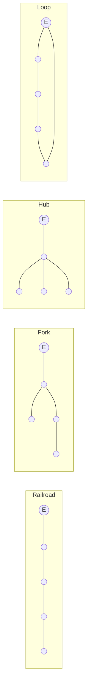
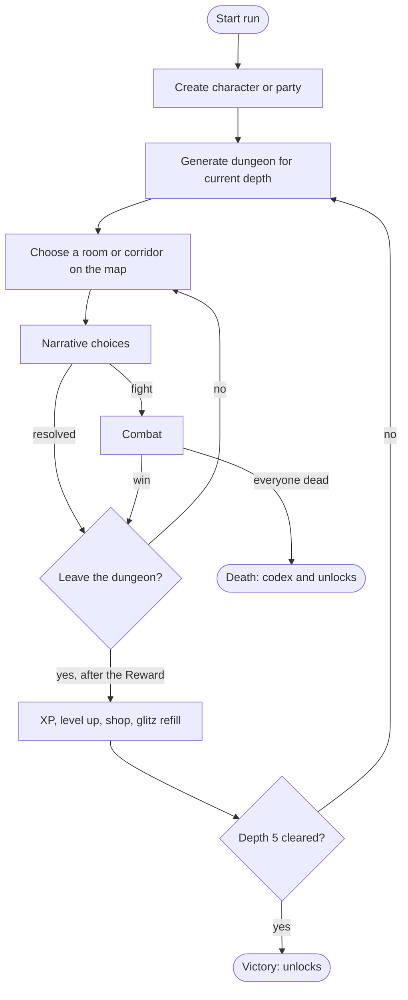
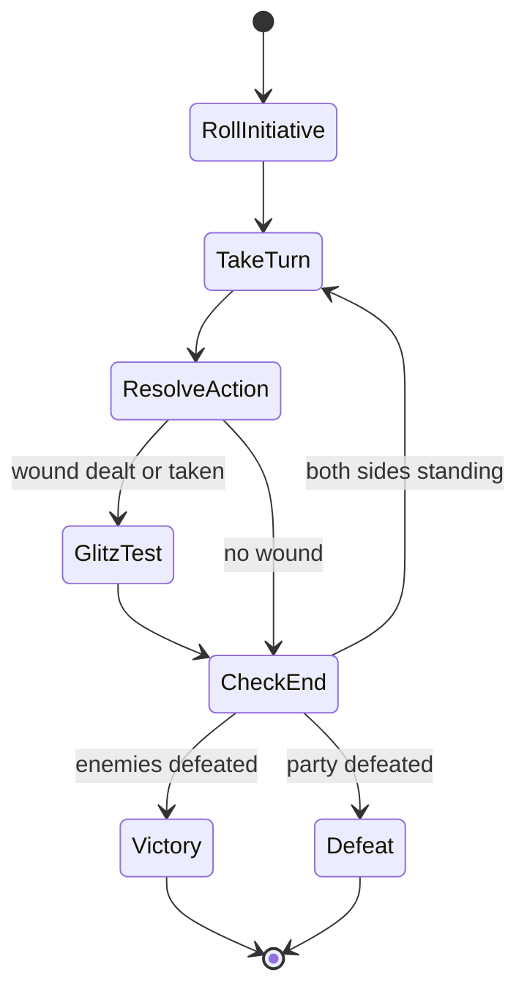
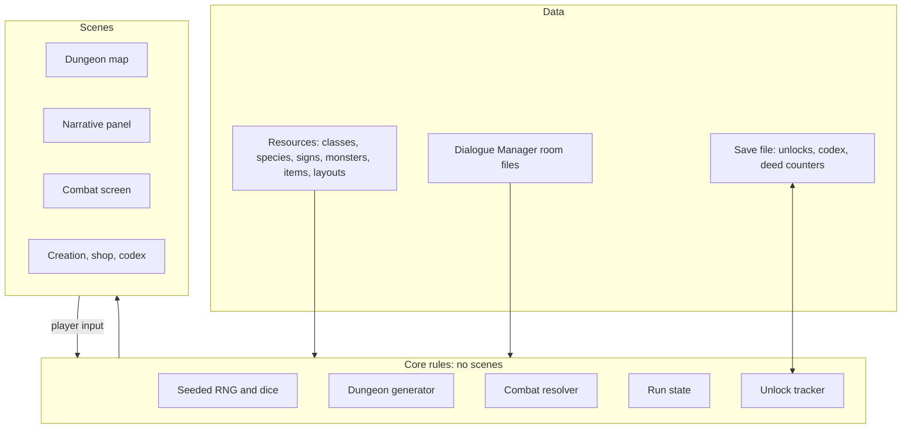

# Five Room Roguelite: Game Design Overview

Working title. Version 0.3, October 2026.

This is the overview document. Each implementation slice listed under
[Build plan](#build-plan) gets its own document when work on it starts;
this one records the concept, the systems at a high level, and the
decisions made so far. Items marked *(proposed)* have been suggested but
not yet confirmed.

## Summary

A roguelite in which the player delves a sequence of procedurally
assembled five-room dungeons beneath Kallistopolis, a vertical
arcanopunk city. Each room is presented as Fighting Fantasy-style
choose-your-own-adventure text, and fights play out as JRPG-style
turn-based combat in initiative order. The game is built around the Law
of Fives: five classes, five species, five ability scores, five signs,
five damage types, five rooms per dungeon, five dungeons per run, five
factions and five levels. All dice are d5s.

Play starts with a solo character. Once five different characters have
been played, a party mode unlocks in which the player fields three to
five characters against larger and harder encounters. Meta-progression
is pure unlocks: new options and new content, never more power.

## Design pillars

1. **Everything comes in fives.** When a list needs a length, it is
   five. Hidden 23s (2 + 3 = 5) are scattered as easter eggs.
2. **Every build reads the dungeon differently.** Room choices are
   gated by stats, class, species and sign, so the same template plays
   differently with a different character.
3. **Wider, not stronger.** Unlocks widen the pool of options, room
   templates and layouts. A first run and a hundredth run are equally
   winnable.
4. **Death means something.** Every death advances the codex and the
   unlock tracks, and slowly reveals the city's conspiracies.

## Setting and tone

All dungeons lie in or beneath Kallistopolis, a single vertical
arcanopunk city in the spirit of Eberron's Sharn: lightning rails,
magewright guilds, bound elementals and towers built on older ruins.
The name combines *kallisti*, the word inscribed on Eris's golden
apple, with *polis*.

The tone sits between straight fantasy and Discordian absurdity. The
game is inspired by Discordianism and the *Illuminatus!* trilogy but
makes no direct contemporary references; real-world figures and ideas
appear as in-world counterparts. Story details will be refined during
development.

| Source | In-world counterpart |
| --- | --- |
| Eris | Eris, goddess of discord, worshipped openly by a minority |
| Emperor Norton | A self-proclaimed emperor of the city whose decrees are inexplicably obeyed |
| Greyface | The Grey Bureau, bureaucrats imposing joyless order |
| The Illuminati | The Lightning Pentad, secret guilds controlling the rail network |
| Fnord | A ward-glyph that renders whatever it is carved on imperceptible |
| The golden apple | The ultimate prize, inscribed "to the fairest" |
| The Sacred Chao | A holy symbol, half order and half chaos |
| The Discordian seasons | The five signs a character can be born under |

### Factions

Five factions, one per dungeon depth, framed as rival conspiracies.
These are working names and will be refined.

| Depth | Faction | Character |
| --- | --- | --- |
| 1 | The Imperial Court | Followers of the self-proclaimed emperor; comic and theatrical |
| 2 | The Grey Bureau | Sinister bureaucrats imposing order |
| 3 | The Order of the Unseen Glyph | Keepers of the ward that makes things imperceptible |
| 4 | The Lightning Pentad | The secret guilds running the rail network |
| 5 | The Apple Court | Eris's own cult, guarding the golden apple |

## Core rules

### Dice

Every roll uses d5s.

| Roll | Used for | Range | Average |
| --- | --- | --- | --- |
| 3d5 | Ability scores | 3–15 | 9 |
| 2d5 + modifier | Checks, attacks, initiative | 2–10 before modifier | 6 |
| 1d5 + 5 | Starting glitz | 6–10 | 8 |
| 1d5 + hits modifier | Health gained per level | Minimum 1 *(proposed)* | 3 |

### Modifiers

An ability score's modifier is (score − 9) ÷ 2, rounded down, giving
−3 to +3.

| Score | 3 | 4–5 | 6–7 | 8–9 | 10–11 | 12–13 | 14–15 |
| --- | --- | --- | --- | --- | --- | --- | --- |
| Modifier | −3 | −3 / −2 | −2 / −1 | −1 / 0 | 0 / +1 | +1 / +2 | +2 / +3 |

In code this is `floori((score - 9) / 2.0)`: a score of 8 gives −1, 9
gives 0, 11 gives +1 and 15 gives +3.

### Checks

A check is 2d5 + the relevant modifier against a target number. The
check succeeds if the total equals or beats the target.

| Difficulty | Target | Chance at +0 | Chance at +3 |
| --- | --- | --- | --- |
| Easy | 6 | 60% | 96% |
| Moderate | 8 | 24% | 76% |
| Hard | 10 | 4% | 40% |

## Characters

### Creation stages

Character creation has five stages, in this order.

### Species

Elf, gnome, dwarf, human and orc. Each species grants one
rule-bending passive rather than a flat stat bonus, so that no species
and class pairing is obviously best.

| Species | Passive *(proposed)* |
| --- | --- |
| Elf | Sees one extra option in Puzzle and Roleplay rooms |
| Gnome | Shop discount; can appraise cursed items |
| Dwarf | Ignores the first trap in each dungeon |
| Human | +1 to an ability score of the player's choice |
| Orc | Gains class resource when wounded |

### Classes

Fighter, mage, rogue, cleric and bard. Each class has five actions,
one unlocked per level, so a level 5 character has a complete kit.

| Class | Focus | Resource *(proposed)* |
| --- | --- | --- |
| Fighter | Weapon attacks, stances | Momentum, built by landing hits |
| Mage | Elemental attacks | Surge, powerful but can backfire |
| Rogue | Evasion, first strikes, escape | Tricks, limited per dungeon |
| Cleric | The only healer | Faith, gained by not testing glitz |
| Bard | Debuffs, taunts, mid-fight parley | Repertoire, each song once per dungeon |

### Signs

Signs replace D&D-style backgrounds. Every character is born under one
of the five Discordian seasons, which grants a boon and a curse. Signs
affect only the character born under them. In party mode, each party
member must have a different sign. A new save starts with Bureaucracy
only, so every new adventurer begins as a pen-pusher.

| Sign | Boon *(proposed)* | Curse *(proposed)* |
| --- | --- | --- |
| Chaos | Reroll one die per dungeon | Random events are more frequent |
| Discord | Bonus damage while wounded | Cannot parley with guardians |
| Confusion | An extra hidden option in puzzles | Some options are mislabelled |
| Bureaucracy | Traps are signposted; shops are cheaper | Must take rooms in a fixed order |
| The Aftermath | Gains glitz when near death | Starts each dungeon wounded |

### Ability scores

Five scores, each rolled on 3d5 at creation.

| Score | Covers |
| --- | --- |
| Hits | Melee attack and health |
| Blitz | Speed, dodging, initiative and defence |
| Wits | Intellect, puzzles, perception |
| Whizz | Magic |
| Rizz | Charisma, parley, recruitment |

A player who dislikes a roll may reroll one score for 1 point of that
character's starting glitz.

### Derived values

| Value | Formula |
| --- | --- |
| Health at level 1 | Hits score + 10 |
| Health per level after 1 | 1d5 + hits modifier |
| Defence | 6 + blitz modifier + armour |
| Initiative | 2d5 + blitz modifier, rolled once per fight |

An average character has about 19 health at level 1 and about 31 at
level 5.

### Glitz

Glitz is luck, in the style of Fighting Fantasy's Luck.

- Each character rolls 1d5 + 5 glitz at creation.
- The party's glitz pool is the sum of every member's glitz, so it
  scales with party size.
- A glitz test is rolled against the acting character's own glitz
  score: 2d5 equal to or under the score succeeds *(proposed)*.
- Each test costs 1 point from the pool, win or lose.
- Glitz partially refills between dungeons: half the party's starting
  pool, rounded up *(proposed amount)*.

Separating the pool (what the party can afford) from the individual
score (how likely a test is to succeed) stops a large party from
passing every test.

### Bits

Bits *(proposed name)* are the currency, shared by the whole party and
spent at shops and merchants.

## Game modes

### Solo

The starting mode. One character delves until death or victory.
Internally, solo is a party of one, so both modes share one combat
system.

### Party

Unlocks once the player has played five different characters. The
player builds three to five characters at the start of a run, each
with a different sign. Encounters field more and harder enemies.

- Experience is shared across the party.
- Recruits join at the party's current level.
- Characters can be recruited or replaced in some Puzzle and Roleplay
  rooms, and occasionally bought from a wandering merchant.
- Glitz and bits are shared.
- The run continues until every party member is dead.

## Dungeons

### The five rooms

Each dungeon draws one template for each of the five room types and
links them with corridors filled with random encounters. The suggested
stats are a guideline for template authors, so that each room type
favours different builds; the engine does not enforce them.

| Room | Purpose | Suggested stats |
| --- | --- | --- |
| 1. Entrance and Guardian | Establishes tone; a fight or barrier | Hits or blitz |
| 2. Puzzle or Roleplay | Non-combat challenge; recruitment in party mode | Wits or rizz |
| 3. Trick or Setback | A twist: trap, betrayal, false treasure | Wits or glitz |
| 4. Climax | The boss fight | Combat |
| 5. Reward and Revelation | Loot, plus a hook that seeds the next dungeon | Rizz |

### Layouts

Five rooms can be connected in 21 distinct topologies, and placing the
entrance on topologically different rooms gives 61 forms in total.
This comes from the paper on five-node graph topologies discussed in
Gnome Stew's articles on the forms of the five room dungeon.

Layouts are an unlock track. A new save has only the Railroad, a
straight line of five rooms. The remaining topologies unlock over time,
plus two secret layouts *(proposed)*, such as a six-room form with a
hidden room, bringing the total to 23. Each dungeon draws its layout at
random from the unlocked pool.

Some example layouts:

### Placing room roles

Branching and looping layouts need rules for where each room role goes,
so that the Climax is not found first.

1. The Entrance and Guardian room is the entrance node.
2. The Climax is the node furthest from the entrance. Ties are broken
   at random.
3. The Reward and Revelation room is locked until the Climax is won,
   because the boss carries the key. It can sit anywhere without being
   reached early.
4. The Puzzle and Trick rooms fill the remaining nodes.

Rooms are skippable wherever the layout allows. Skipping a room avoids
its hazards and forgoes its loot and experience; balancing the two is
the player's choice. In party mode this means a recruitment room can be
missed.

### Generation

1. Seed the run's random number generator.
2. Select the dungeon's faction from the run's depth.
3. Draw a layout from the unlocked pool.
4. Place the room roles on the layout's nodes.
5. For each role, draw a template from the unlocked pool.
6. Fill each corridor with encounters scaled to party level and size.
7. Apply the previous dungeon's revelation, if any.

All randomness flows from the run seed, so runs are reproducible and
bugs can be replayed.

## The run

A full run is five dungeons, with the party reaching level 5. Between
dungeons the party gains experience, levels up, visits the shop and
partially refills glitz. Each dungeon scales to the party's level and
size.

## Combat

Combat is turn-based in initiative order, in the style of JRPGs and
D&D. Initiative is rolled once at the start of each fight and the order
then stays fixed, so players can plan ahead.

### Attacks and damage

Damage uses margin of success, so each attack needs only one roll.

1. The attacker rolls 2d5 + the attack's modifier (hits for weapons,
   whizz for spells).
2. If the total equals or beats the target's defence, the attack hits.
3. Damage is the margin by which the total beat the defence, plus the
   weapon's or spell's damage bonus.
4. The target's resistances and weaknesses then adjust the damage
   *(rules to be decided)*.

For example, a fighter with a hits modifier of +2 attacks a defence of
7 and rolls 8. The total is 10, a margin of 3; with a sword's bonus of
+2, the hit deals 5 damage.

### Glitz in combat

After any wound is dealt or received, the player may test glitz.
Success improves the outcome (more damage dealt, or less taken);
failure worsens it. Each test costs 1 point from the pool.

### Damage types

| Type | Source |
| --- | --- |
| Brawn | Weapons, fists, claws and other physical force |
| Flame | Fire magic and alchemy |
| Frost | Cold magic and bound ice elementals |
| Spark | Lightning, the city's lightning rails, magewright devices |
| Discord | Chaos magic; Eris's own element, rare and hard to resist |

### Other combat details

- Each combatant chooses from their class actions, items, or fleeing.
- Class resources build and spend during combat.
- Party mode fields more enemies per encounter.

## Meta-progression

Meta-progression is pure unlocks. Nothing carried between runs makes a
character stronger.

### Starting state

A new save has a human fighter born under Bureaucracy, the Railroad
layout, and the starting templates for each room type.

### Unlock tracks

| Track | Unlocked by *(proposed)* |
| --- | --- |
| Species | Reaching new dungeon depths |
| Classes | Demonstrating the playstyle, for example parleying past five guardians unlocks the bard |
| Signs | Cheap, frequent deeds |
| Room templates | Deeds tied to that room type, such as dying in a trick room five times |
| Layouts | Clearing dungeons and exploring every room in them |
| Party mode | Playing five different characters (confirmed) |
| Codex | One fragment per death, 23 in total; completing it unlocks the true final room |

Unlock thresholds use counts of 5 or 23. Unlocked templates are weirder
rather than harder.

## Technical approach

| Area | Decision |
| --- | --- |
| Engine | Godot 4 |
| Language | GDScript |
| Stats and entities | Godot `Resource` files |
| Room narrative | The Dialogue Manager plugin |
| Randomness | One seeded generator per run |
| Art | Free sprites first; custom animated sprites as a stretch goal |
| Layout | Dungeon map alongside a main panel that switches between narrative and combat views |

### Architecture

The game rules live in plain GDScript classes with no dependency on
scenes or nodes, so they can be tested and simulated in isolation.
Scenes only display state and pass player input back.

## Build plan

Each slice below gets its own document when work starts. The aim is a
playable solo run as early as possible, then content, then party mode.

1. **Project skeleton.** Godot project, folder layout, seeded RNG and
   d5 dice, a test framework, and the first `Resource` types.
2. **Character creation.** Human fighter born under Bureaucracy;
   rolling scores, derived values and glitz rerolls.
3. **Room narrative.** Dialogue Manager integration, displaying room
   text and choices, and stat checks.
4. **Combat.** Initiative, margin-of-success attacks and glitz tests
   for a party of one against one or more enemies.
5. **Dungeon generation and map.** The Railroad layout, role placement,
   templates and corridors; the map view.
6. **The run loop.** Experience, levelling, the shop, glitz refill and
   scaling across five dungeons.
7. **Meta-progression and saving.** Unlock tracks, deed counters and
   the codex.
8. **Content.** The remaining species, classes, signs, templates,
   layouts and factions.
9. **Party mode.** Three to five characters, recruitment and
   replacement, the shared pool.
10. **Art pass.** Custom animated sprites.

## Decision log

| Date | Decision |
| --- | --- |
| Earlier | Meta-progression is pure unlocks |
| 2026-10-29 | Godot 4 with GDScript; `Resource` files for stats |
| 2026-10-29 | Dialogue Manager for room narrative |
| 2026-10-29 | Free sprites first; animated custom sprites as a stretch goal |
| 2026-10-29 | Party mode unlocks after five characters played; party of three to five |
| 2026-10-29 | Party built at start; recruit or replace in some Puzzle and Roleplay rooms and from merchants |
| 2026-10-29 | Run ends when every party member is dead |
| 2026-10-29 | Glitz and bits shared across the party; XP shared; recruits join at level |
| 2026-10-29 | Signs replace backgrounds; season names kept; one per character, unique within a party |
| 2026-10-29 | Fifth ability score is blitz |
| 2026-10-29 | All dice are d5s: 3d5 abilities, 2d5 + modifier for checks |
| 2026-10-29 | Modifier = (score − 9) ÷ 2 rounded down; targets 6, 8 and 10 |
| 2026-10-29 | Ability scores rolled; rerolling one costs 1 starting glitz |
| 2026-10-29 | Glitz 1d5 + 5 per character; pool is the sum; tests against the individual's score |
| 2026-10-29 | Glitz partially refills between dungeons |
| 2026-10-29 | Initiative rolled once per fight |
| 2026-10-29 | Margin-of-success damage; fixed defence per character |
| 2026-10-29 | Health: hits + 10, then 1d5 + hits modifier per level |
| 2026-10-29 | Damage types: brawn, flame, frost, spark, discord |
| 2026-10-29 | Suggested stats per room are a guideline, not a rule |
| 2026-10-29 | Layouts are an unlock track, drawn freely from the unlocked pool; Railroad first |
| 2026-10-29 | Role placement: entrance fixed, Climax furthest, Reward locked behind Climax |
| 2026-10-29 | Rooms skippable where the layout allows |
| 2026-10-29 | City is Kallistopolis; five factions, one per depth |
| 2026-10-29 | Arcanopunk tone, Discordian-inspired, no contemporary references |
| 2026-10-29 | New saves start with a human fighter born under Bureaucracy |
| 2026-10-29 | gdUnit4 for testing; GitHub Actions on every push; Conventional Commits |
| 2026-10-29 | Five random streams from one seed: characters, dungeon, encounters, combat, loot |
| 2026-10-29 | Compatibility renderer; placeholder art deferred until slice 4 |

## Open questions

1. The exact glitz test roll, and the amount of the partial refill.
2. How resistances and weaknesses modify damage.
3. Weapon, spell and armour values.
4. Each class's five actions and how its resource works.
5. Species passives and sign boons and curses, currently proposals.
6. Experience curve, enemy stat blocks and how encounters scale.
7. The shop, the wandering merchant and recruitment costs.
8. The equipment stage of character creation.
9. Whether "bits" is the currency's final name.

## Next steps

1. Write the slice 1 document: project skeleton, folder layout, seeded
   RNG and d5 dice, and the test framework.
2. Work through open questions 2 to 4 before starting slice 4, since
   combat depends on them.
