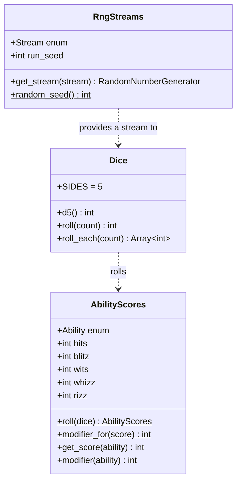

# Slice 1: Project Skeleton

Part of the Five Room Dungeon Roguelite build plan. Version 1.0, October 2026.

This slice sets up the Godot project, the test framework and continuous
integration, and builds the first tested core code: seeded random
streams, a d5 dice roller and ability scores. It produces no gameplay;
it produces the foundations every later slice depends on.

The document has two parts. The [specification](#specification) says
what the slice delivers and why. The [walkthrough](#walkthrough) gives
the steps, editor clicks and code to build it.

## Specification

### Goals

1. A Godot 4.7 project that opens, runs and shows the basic screen
   layout.
2. A test framework that runs locally in the editor and headless in CI
   on every push.
3. Deterministic randomness: the same run seed always produces the
   same results, and each game system has its own random stream.
4. A d5 dice roller and the ability score rules from the design
   overview, fully tested.

### Out of scope

- Species, classes, signs and other `Resource` data (slice 2)
- Dialogue Manager (slice 3)
- Any art, sprites or theming
- Saving and loading

### Decisions

| Area | Decision |
| --- | --- |
| Engine | Godot 4.7.x, standard build (not .NET) |
| Renderer | Compatibility, the lightest renderer and the one used for web exports |
| Test framework | gdUnit4 6.x |
| CI | GitHub Actions running gdUnit4 on every push and pull request |
| Commits | Conventional Commits |
| Randomness | Five named streams derived from one run seed |

### Random streams

Each run has one seed. A master generator seeded with it produces one
seed for each of five streams, in a fixed order:

| Order | Stream | Used for |
| --- | --- | --- |
| 1 | `CHARACTERS` | Ability scores, glitz, recruits |
| 2 | `DUNGEON` | Layouts, role placement, room templates |
| 3 | `ENCOUNTERS` | Corridor encounters and enemy selection |
| 4 | `COMBAT` | Initiative, attacks, glitz tests |
| 5 | `LOOT` | Rewards and shop stock |

Separate streams mean that changing how often combat rolls dice cannot
change the dungeons a seed generates. New streams must only ever be
added to the end of the list; inserting one in the middle would change
every existing seed's results.

### Architecture for this slice



Core classes extend `RefCounted` (logic) or `Resource` (data that will
later be saved or edited in the inspector). They take what they need
through their constructor rather than reaching for global singletons,
which keeps them easy to test.

### Code conventions

| Convention | Rule |
| --- | --- |
| Static typing | Every variable, parameter and return value is typed; untyped declarations are compile errors |
| File length | Aim for under about 100 lines, split by concept; a guideline, not a hard rule |
| Function length | Aim for around 10 lines where feasible |
| Class names | `class_name` on every core class, in PascalCase; file names in snake_case |
| Documentation | `##` doc comments on every class and public function |
| Private members | Prefixed with an underscore |
| Tests | One test file per core file, named `<name>_test.gd`, mirroring the `core/` folder |
| Test structure | `# Arrange`, `# Act` and `# Assert` comments in every test |
| Indentation | Tabs, the Godot default |

### Folder layout

```text
res://
├── addons/
│   └── gdUnit4/
├── core/
│   ├── character/
│   │   └── ability_scores.gd
│   └── dice/
│       ├── dice.gd
│       └── rng_streams.gd
├── data/
├── docs/
│   ├── 00-overview.md
│   └── 01-project-skeleton.md
├── narrative/
├── tests/
│   └── core/
│       ├── character/
│       │   └── ability_scores_test.gd
│       └── dice/
│           ├── dice_test.gd
│           └── rng_streams_test.gd
├── ui/
│   └── main/
│       └── main.tscn
└── project.godot
```

### Definition of done

- [ ] The project opens in Godot 4.7.x with no errors or warnings.
- [ ] Running the project shows the placeholder map and content panels.
- [ ] All tests pass in the editor's gdUnit4 panel.
- [ ] All tests pass in GitHub Actions on push.
- [ ] Two `RngStreams` built from the same seed produce identical
      sequences; drawing from one stream does not change another.
- [ ] `Dice` only ever returns 1 to 5 for a d5, and every face occurs.
- [ ] `AbilityScores.modifier_for` matches the table in the design
      overview, and rolled scores fall between 3 and 15.
- [ ] Commits follow Conventional Commits.

## Walkthrough

### Step 1: Install the tools

1. Download the **standard** Godot 4.7.x build from
   [godotengine.org](https://godotengine.org/download), not the .NET
   build. Note the exact version (for example 4.7.1); CI must match it.
2. Make sure `git` is installed and you can push to GitHub.

### Step 2: Create the repository and project

1. Create an empty GitHub repository, for example
   `five-room-dungeon-roguelite`, and clone it.
2. Open Godot. In the Project Manager, choose **Create**.
3. Set the project path to your cloned folder, and choose the
   **Compatibility** renderer.
4. Godot creates `project.godot` and an `icon.svg`.

Add these two files at the repository root.

`.gitignore`:

```gitignore
# Godot cache and imports
.godot/

# Android export templates
/android/

# gdUnit4 test reports
reports/
```

`.gitattributes`:

```gitattributes
* text=auto eol=lf
```

Commit: `chore: initialise Godot 4.7 project`.

### Step 3: Configure the project

Open **Project → Project Settings**.

#### General settings

| Setting | Value |
| --- | --- |
| Application → Config → Name | Five Room Dungeon Roguelite |
| Display → Window → Size → Viewport Width | 1280 |
| Display → Window → Size → Viewport Height | 720 |
| Display → Window → Stretch → Mode | `canvas_items` |
| Display → Window → Stretch → Aspect | `expand` |

#### GDScript warnings

Switch on the **Advanced Settings** toggle at the top right of the
Project Settings window, then go to **Debug → GDScript**.

| Setting | Value | Why |
| --- | --- | --- |
| Untyped Declaration | Error | Enforces static typing everywhere |
| Unsafe Property Access | Warn | Flags dynamic property lookups |
| Unsafe Method Access | Warn | Flags calls the editor cannot check |
| Unsafe Cast | Warn | Flags casts that may fail at runtime |
| Directory Rules | Leave the default: `res://addons` set to Exclude | Stops plugins from tripping your stricter rules; this replaced the older Exclude Addons tick box |

#### Editor settings

In **Editor → Editor Settings → Text Editor → Completion**, switch on
**Add Type Hints**, so autocompleted code is typed by default.

Commit: `chore: configure display and strict typing`.

### Step 4: Create the folders

In the **FileSystem** dock, right-click `res://` and choose
**Create New → Folder** for each of: `core/character`, `core/dice`,
`data`, `docs`, `narrative`, `tests/core/character`, `tests/core/dice`
and `ui/main`.

Godot does not track empty folders in git. Add an empty `.gitkeep`
file to `data/` and `narrative/` from your terminal so they are
committed.

Copy the design overview into `docs/design-overview.md` and this
document into `docs/slice-01-project-skeleton.md`.

Commit: `chore: add folder structure and design docs`.

### Step 5: Install gdUnit4

1. Open the **AssetLib** (asset store) tab at the top of the editor and
   search for **gdUnit4**. Install it, making sure only the
   `addons/gdUnit4` folder is selected. If it is not listed, download
   the latest 6.x release from the gdUnit4 GitHub repository and copy
   its `addons/gdUnit4` folder into your project.
2. Go to **Project → Project Settings → Plugins** and enable gdUnit4.
3. Restart the editor when prompted. A **GdUnit** panel appears in the
   dock area.

Commit the addon so everyone and CI use the same version:
`build: add gdUnit4 test framework`.

### Step 6: Random streams, test first

Create `tests/core/dice/rng_streams_test.gd`. To create a script, right
click the folder in the FileSystem dock and choose
**Create New → Script**, then replace its contents.

```gdscript
extends GdUnitTestSuite
## Tests for RngStreams: determinism and independence of streams.

const SEED := 23


func test_same_seed_gives_same_sequence() -> void:
	# Arrange
	var first := RngStreams.new(SEED)
	var second := RngStreams.new(SEED)

	# Act
	var first_draws := _draw(first, RngStreams.Stream.COMBAT, 10)
	var second_draws := _draw(second, RngStreams.Stream.COMBAT, 10)

	# Assert
	assert_array(first_draws).is_equal(second_draws)


func test_different_seeds_give_different_sequences() -> void:
	# Arrange
	var first := RngStreams.new(SEED)
	var second := RngStreams.new(SEED + 1)

	# Act
	var first_draws := _draw(first, RngStreams.Stream.COMBAT, 10)
	var second_draws := _draw(second, RngStreams.Stream.COMBAT, 10)

	# Assert
	assert_array(first_draws).is_not_equal(second_draws)


func test_streams_are_independent() -> void:
	# Arrange
	var untouched := RngStreams.new(SEED)
	var disturbed := RngStreams.new(SEED)
	_draw(disturbed, RngStreams.Stream.COMBAT, 100)

	# Act
	var expected := _draw(untouched, RngStreams.Stream.DUNGEON, 10)
	var actual := _draw(disturbed, RngStreams.Stream.DUNGEON, 10)

	# Assert
	assert_array(actual).is_equal(expected)


func _draw(streams: RngStreams, stream: RngStreams.Stream, count: int) -> Array[int]:
	var rng := streams.get_stream(stream)
	var draws: Array[int] = []
	for _i: int in range(count):
		draws.append(rng.randi())
	return draws
```

The editor shows errors, because `RngStreams` does not exist yet. That
is expected: the test describes the behaviour before the code exists.

Now create `core/dice/rng_streams.gd`:

```gdscript
class_name RngStreams
extends RefCounted
## Independent random streams for one run, all derived from the run seed.
##
## Each game system draws from its own stream, so changing how one
## system uses randomness cannot change the results of another. New
## streams must only be added to the end of the enum, never inserted,
## or every existing seed will produce different runs.

enum Stream { CHARACTERS, DUNGEON, ENCOUNTERS, COMBAT, LOOT }

var run_seed: int
var _streams: Array[RandomNumberGenerator] = []


func _init(seed_value: int) -> void:
	run_seed = seed_value
	var master := RandomNumberGenerator.new()
	master.seed = seed_value
	for _i: int in range(Stream.size()):
		_streams.append(_make_stream(master.randi()))


## Returns the generator for one stream.
func get_stream(stream: Stream) -> RandomNumberGenerator:
	return _streams[stream]


## Returns a fresh, unpredictable seed for starting a new run.
static func random_seed() -> int:
	var rng := RandomNumberGenerator.new()
	rng.randomize()
	return rng.randi()


func _make_stream(stream_seed: int) -> RandomNumberGenerator:
	var rng := RandomNumberGenerator.new()
	rng.seed = stream_seed
	return rng
```

The parameter is called `seed_value` rather than `seed` because
`seed()` is a built-in global function, and shadowing it produces a
warning.

#### Running the tests

Right-click `tests/` in the FileSystem dock and choose **Run Tests**.
The GdUnit panel shows the results; all three tests should pass. To see
a test fail, temporarily change `SEED + 1` to `SEED` in the second test.

Commit: `feat(dice): add seeded random streams`.

### Step 7: The d5 dice roller

Create `tests/core/dice/dice_test.gd`:

```gdscript
extends GdUnitTestSuite
## Tests for Dice: ranges, coverage of every face, and determinism.

const SEED := 23
const ROLLS := 1000


func test_d5_stays_within_one_to_five() -> void:
	# Arrange
	var dice := _make_dice(SEED)

	# Act
	var results := _roll_d5s(dice, ROLLS)

	# Assert
	assert_bool(results.all(func(r: int) -> bool: return r >= 1 and r <= 5)).is_true()


func test_d5_rolls_every_face() -> void:
	# Arrange
	var dice := _make_dice(SEED)

	# Act
	var results := _roll_d5s(dice, ROLLS)

	# Assert
	assert_array(results).contains([1, 2, 3, 4, 5])


func test_roll_totals_stay_within_range() -> void:
	# Arrange
	var dice := _make_dice(SEED)

	# Act
	var totals: Array[int] = []
	for _i: int in range(ROLLS):
		totals.append(dice.roll(3))

	# Assert
	assert_bool(totals.all(func(t: int) -> bool: return t >= 3 and t <= 15)).is_true()


func test_roll_each_returns_one_result_per_die() -> void:
	# Arrange
	var dice := _make_dice(SEED)

	# Act
	var results := dice.roll_each(2)

	# Assert
	assert_array(results).has_size(2)


func test_same_seed_gives_same_rolls() -> void:
	# Arrange
	var first := _make_dice(SEED)
	var second := _make_dice(SEED)

	# Act
	var first_rolls := _roll_d5s(first, 20)
	var second_rolls := _roll_d5s(second, 20)

	# Assert
	assert_array(first_rolls).is_equal(second_rolls)


func _make_dice(seed_value: int) -> Dice:
	var streams := RngStreams.new(seed_value)
	return Dice.new(streams.get_stream(RngStreams.Stream.COMBAT))


func _roll_d5s(dice: Dice, count: int) -> Array[int]:
	var results: Array[int] = []
	for _i: int in range(count):
		results.append(dice.d5())
	return results
```

Then create `core/dice/dice.gd`:

```gdscript
class_name Dice
extends RefCounted
## Rolls d5s from a single random stream.

const SIDES := 5

var _rng: RandomNumberGenerator


func _init(rng: RandomNumberGenerator) -> void:
	_rng = rng


## Rolls a single d5.
func d5() -> int:
	return _rng.randi_range(1, SIDES)


## Rolls several d5s and returns each result, for showing dice on screen.
func roll_each(count: int) -> Array[int]:
	var results: Array[int] = []
	for _i: int in range(count):
		results.append(d5())
	return results


## Rolls several d5s and returns their total.
func roll(count: int) -> int:
	var total := 0
	for result: int in roll_each(count):
		total += result
	return total
```

Run the tests again. All eight should pass.

Commit: `feat(dice): add d5 dice roller`.

### Step 8: Ability scores

Create `tests/core/character/ability_scores_test.gd`. The first test is
a parameterised test: gdUnit4 runs it once for each row in
`test_parameters`.

```gdscript
extends GdUnitTestSuite
## Tests for AbilityScores: the modifier rule and rolling.

const SEED := 23


func test_modifier_for(score: int, expected: int, test_parameters := [
		[3, -3], [4, -3], [5, -2], [8, -1], [9, 0],
		[10, 0], [11, 1], [14, 2], [15, 3]]) -> void:
	# Arrange
	# The score and expected modifier come from test_parameters.

	# Act
	var actual := AbilityScores.modifier_for(score)

	# Assert
	assert_int(actual).is_equal(expected)


func test_modifier_uses_the_named_score() -> void:
	# Arrange
	var scores := AbilityScores.new()
	scores.wits = 15

	# Act
	var actual := scores.modifier(AbilityScores.Ability.WITS)

	# Assert
	assert_int(actual).is_equal(3)


func test_roll_gives_scores_from_three_to_fifteen() -> void:
	# Arrange
	var dice := _make_dice(SEED)

	# Act
	var scores := AbilityScores.roll(dice)

	# Assert
	assert_int(scores.hits).is_between(3, 15)
	assert_int(scores.blitz).is_between(3, 15)
	assert_int(scores.wits).is_between(3, 15)
	assert_int(scores.whizz).is_between(3, 15)
	assert_int(scores.rizz).is_between(3, 15)


func test_same_seed_rolls_same_scores() -> void:
	# Arrange
	var first_dice := _make_dice(SEED)
	var second_dice := _make_dice(SEED)

	# Act
	var first := AbilityScores.roll(first_dice)
	var second := AbilityScores.roll(second_dice)

	# Assert
	assert_int(first.hits).is_equal(second.hits)
	assert_int(first.rizz).is_equal(second.rizz)


func _make_dice(seed_value: int) -> Dice:
	var streams := RngStreams.new(seed_value)
	return Dice.new(streams.get_stream(RngStreams.Stream.CHARACTERS))
```

Then create `core/character/ability_scores.gd`:

```gdscript
class_name AbilityScores
extends Resource
## A character's five ability scores and the modifiers derived from them.

enum Ability { HITS, BLITZ, WITS, WHIZZ, RIZZ }

const DICE_PER_SCORE := 3
const AVERAGE_SCORE := 9

@export_range(3, 15) var hits: int = AVERAGE_SCORE
@export_range(3, 15) var blitz: int = AVERAGE_SCORE
@export_range(3, 15) var wits: int = AVERAGE_SCORE
@export_range(3, 15) var whizz: int = AVERAGE_SCORE
@export_range(3, 15) var rizz: int = AVERAGE_SCORE


## Rolls all five scores on 3d5, always in the same order.
static func roll(dice: Dice) -> AbilityScores:
	var scores := AbilityScores.new()
	scores.hits = dice.roll(DICE_PER_SCORE)
	scores.blitz = dice.roll(DICE_PER_SCORE)
	scores.wits = dice.roll(DICE_PER_SCORE)
	scores.whizz = dice.roll(DICE_PER_SCORE)
	scores.rizz = dice.roll(DICE_PER_SCORE)
	return scores


## The modifier for a score: (score - 9) / 2, rounded down.
static func modifier_for(score: int) -> int:
	return floori((score - AVERAGE_SCORE) / 2.0)


## Returns the score for one ability.
func get_score(ability: Ability) -> int:
	match ability:
		Ability.HITS:
			return hits
		Ability.BLITZ:
			return blitz
		Ability.WITS:
			return wits
		Ability.WHIZZ:
			return whizz
		_:
			return rizz


## Returns the modifier for one ability.
func modifier(ability: Ability) -> int:
	return modifier_for(get_score(ability))
```

The rolling order is fixed (hits, blitz, wits, whizz, rizz) for the
same reason as the stream order: changing it would change every seed's
characters.

`floori` matters here. Integer division in GDScript truncates towards
zero, so `(8 - 9) / 2` would give 0 rather than −1. Dividing by `2.0`
and flooring gives the correct result for negative modifiers; the
parameterised test checks this.

Run the tests. All should pass, with `test_modifier_for` listed once for
each parameter row.

Commit: `feat(character): add ability scores and modifiers`.

### Step 9: The main scene

This scene is a placeholder for the layout: a map on the left and the
narrative and combat panel on the right.

1. **Scene → New Scene**, then choose **User Interface** as the root
   node. Rename the root `Main`.
2. With `Main` selected, use the **Anchor Preset** toolbar button and
   choose **Full Rect**.
3. Add a child `HBoxContainer`, also set to **Full Rect**.
4. Under it, add two `PanelContainer` nodes named `MapPanel` and
   `ContentPanel`.
5. On both panels, in the Inspector, set
   **Layout → Container Sizing → Horizontal** to **Fill** and tick
   **Expand**. Set `MapPanel`'s **Stretch Ratio** to 1 and
   `ContentPanel`'s to 2, so the content panel takes two thirds of
   the width.
6. Add a `Label` under each panel with the text `Map` and
   `Narrative and combat`. Set each label's horizontal and vertical
   alignment to **Center**.
7. Save the scene as `ui/main/main.tscn`.
8. In **Project → Project Settings → Application → Run**, set
   **Main Scene** to `res://ui/main/main.tscn`.

Press **F5** to run the project. You should see the two labelled
panels, resizing with the window.

Commit: `feat(ui): add placeholder main layout`.

### Step 10: Continuous integration

Create `.github/workflows/tests.yml` at the repository root:

```yaml
name: Tests

on:
  push:
  pull_request:

jobs:
  gdunit4:
    runs-on: ubuntu-latest
    steps:
      - uses: actions/checkout@v4

      - uses: MikeSchulze/gdUnit4-action@v1
        with:
          godot-version: '4.7.1'
          paths: 'res://tests'
```

Set `godot-version` to the exact version you installed in step 1. The
action downloads that Godot build, runs every test under `res://tests`
headless and publishes a report on the workflow run. Check the action's
README if an input has changed since this was written.

Commit: `ci: run gdUnit4 tests on push`, push, and open the **Actions**
tab on GitHub to watch the run.

### Step 11: Check the definition of done

Work through the checklist in [Definition of done](#definition-of-done).
When everything is ticked, tag the commit:

```bash
git tag slice-01
git push --tags
```

## Troubleshooting

| Symptom | Likely cause |
| --- | --- |
| `Identifier "RngStreams" not declared` in a test | The class file has a parse error, or its `class_name` line is missing; open it and check the error list |
| An error about an untyped variable | A declaration is missing a type; use `: Type` or `:=` |
| Tests pass locally but CI cannot find them | `paths` in the workflow does not match the folder, or the gdUnit4 addon was not committed |
| CI fails with a Godot download error | `godot-version` does not match a published Godot release |
| `test_modifier_for` gives 0 for a score of 8 | The division uses integers; it must divide by `2.0` and use `floori` |

## Next slice

Slice 2, character creation, builds on this one: the `Species`,
`CharacterClass` and `Sign` resources, the human fighter born under
Bureaucracy, derived values (health, defence, glitz), and rerolling a
score for 1 glitz.
