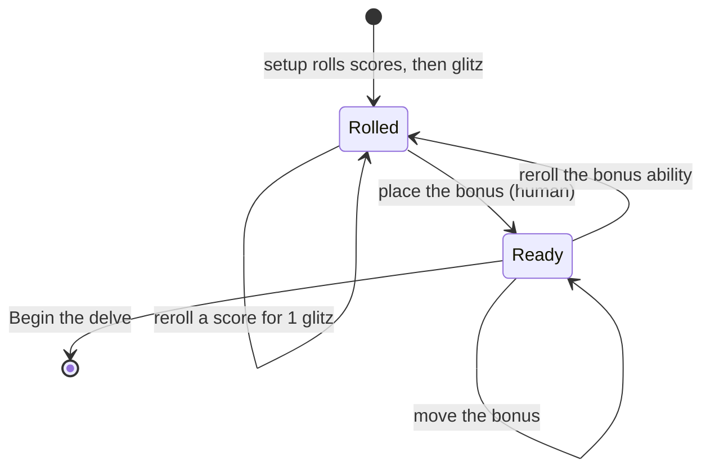
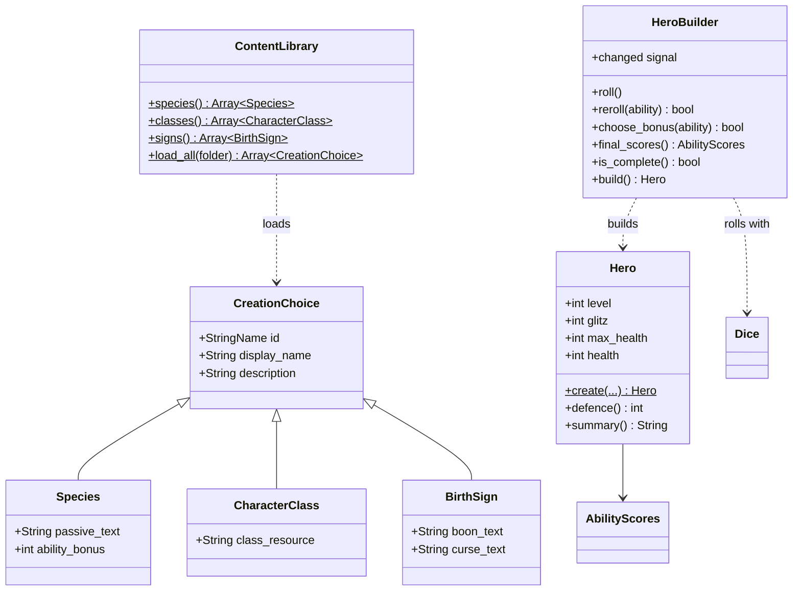

# Slice 2: Character Creation

Part of the Five Room Dungeon Roguelite build plan. Version 1.0, October
2026.

This slice turns the slice 1 foundations into a playable first screen. The
player picks a species, class and sign, sees their rolled ability scores,
spends glitz on rerolls, places the human bonus point and confirms the
hero. Only the starting choices exist: a human fighter born under
Bureaucracy.

All the code in this document has been run against Godot 4.7.2 with
gdUnit4 6.2.0: every test passes and no script raises a warning under the
project's strict typing settings.

## Specification

### Goals

1. Data resources for species, classes and signs, edited in the inspector
   and loaded from `res://data`.
2. A `Hero` with the derived values from the design overview: health,
   defence and glitz.
3. A `HeroBuilder` that rolls scores and glitz, sells rerolls for glitz and
   applies the human bonus, fully tested.
4. A creation screen in the content panel; confirming it shows the hero's
   summary in the map panel.

### Out of scope

- The other four species, classes and signs (slice 8)
- Unlock filtering of the choices (slice 7)
- Equipment, weapons and armour (slice 4)
- Mechanical effects of species passives and signs, other than the human
  bonus; for now they are descriptive text only
- Saving the hero

### Decisions to confirm

These were not settled in the design overview. The code implements the
proposals below; each is a constant or a few lines, so it is cheap to
change.

| Question | Proposal | Where it lives |
| --- | --- | --- |
| How low can rerolls take glitz? | Not below 2, the lowest score that can still pass a 2d5 glitz test | `HeroBuilder.MIN_GLITZ` |
| Does a reroll keep the better result? | No; the new roll stands, even if lower | `HeroBuilder.reroll` |
| Can the player reroll everything for free? | No; the only way to change a score is a paid reroll | Creation screen |
| When is the human bonus placed? | After rerolls, and it is required before Begin is enabled | `HeroBuilder.is_complete` |
| Can the bonus raise a score above 15? | No; 16 would give the same +3 modifier as 15 | `HeroBuilder.can_choose_bonus` |
| What if the bonus ability is rerolled? | The bonus is cleared and must be placed again | `HeroBuilder.reroll` |
| Do heroes have names? | Not yet | Not implemented |
| What is the hero's armour? | 0 until equipment arrives in slice 4, so defence is 6 + blitz modifier | `Hero.defence_for` |

### Creation flow



For a species without a bonus, the screen is ready as soon as it is
rolled.

### Order of rolls

Every creation roll comes from the run's `CHARACTERS` stream, in this
order, so a seed always produces the same starting hero:

1. Hits, blitz, wits, whizz and rizz, each on 3d5
2. Glitz on 1d5 + 5
3. Each reroll on 3d5, in the order the player makes them

### Architecture for this slice



`CreationChoice` is a shared base class so that the creation screen can
fill its three drop-down lists with one function. `HeroBuilder` emits
`changed` whenever anything changes, and the screen redraws itself in
response; the builder knows nothing about the screen.

### New and changed files

```text
res://
├── core/
│   ├── character/
│   │   ├── ability_scores.gd        (changed)
│   │   ├── birth_sign.gd
│   │   ├── character_class.gd
│   │   ├── creation_choice.gd
│   │   ├── hero.gd
│   │   ├── hero_builder.gd
│   │   └── species.gd
│   └── content/
│       └── content_library.gd
├── data/
│   ├── classes/fighter.tres
│   ├── signs/bureaucracy.tres
│   └── species/human.tres
├── docs/
│   └── 02-character-creation.md
├── tests/core/
│   ├── character/
│   │   ├── ability_scores_test.gd   (changed)
│   │   ├── hero_builder_test.gd
│   │   └── hero_test.gd
│   └── content/
│       └── content_library_test.gd
└── ui/
    ├── creation/
    │   ├── creation_screen.gd
    │   ├── creation_screen.tscn
    │   └── score_table.gd
    └── main/
        ├── main.gd
        └── main.tscn                (changed)
```

### Definition of done

- [x] The slice 1 tidy-ups are committed.
- [x] The project opens with no errors or warnings.
- [x] Running the project shows the creation screen with the human
      fighter born under Bureaucracy, rolled scores and their modifiers.
- [x] Rerolling costs 1 glitz and stops at 2 glitz.
- [x] Begin stays disabled until the human bonus is placed.
- [x] Pressing Begin hides the creation screen and shows the hero's
      summary in the map panel.
- [x] All tests pass in the editor and in GitHub Actions.
- [x] The work is merged into `main` through a pull request and tagged
      `slice-02`.

## Walkthrough

### Step 1: Create the branch

```bash
git switch main
git pull
git switch -c 5rdr-0002
```

### Step 2: Tidy up slice 1

A review of the slice 1 repository found three small issues.

#### The project name has a typo

`project.godot` has `config/name="Five Roo Dungeon Roguelite"`. Fix it in
**Project → Project Settings → Application → Config → Name**.

#### CI tests with a different gdUnit4 than the editor

The workflow defaults to the latest gdUnit4 release (6.2.2 in the last
run), while the project has 6.2.0 installed. Pin CI to the installed
version by adding a `version` line to `.github/workflows/tests.yml`:

```yaml
      - uses: MikeSchulze/gdUnit4-action@v1
        with:
          godot-version: '4.7.2'
          version: 'installed'
          paths: 'res://tests'
```

To upgrade gdUnit4 later, update the addon in the editor; CI follows.

#### Parameterised tests raise an unused parameter warning

gdUnit4 reads `test_parameters` itself, so the script never uses it and
Godot warns. Add an annotation above `test_modifier_for` in
`tests/core/character/ability_scores_test.gd`:

```gdscript
@warning_ignore("unused_parameter")
func test_modifier_for(score: int, expected: int, test_parameters := [
```

Do the same for every parameterised test from now on.

Commits: `fix: correct project name`, `ci: pin gdUnit4 to the installed
version`, and `test: silence unused parameter warning`.

### Step 3: Extend ability scores

The builder needs to set a single score, copy a set of scores, and show
each ability's name. Add these tests to the end of
`tests/core/character/ability_scores_test.gd`:

```gdscript
func test_set_score_changes_only_that_ability() -> void:
	# Arrange
	var scores := AbilityScores.new()

	# Act
	scores.set_score(AbilityScores.Ability.WHIZZ, 14)

	# Assert
	assert_int(scores.whizz).is_equal(14)
	assert_int(scores.wits).is_equal(AbilityScores.AVERAGE_SCORE)


func test_copy_is_independent_of_the_original() -> void:
	# Arrange
	var original := AbilityScores.new()
	original.rizz = 12

	# Act
	var copied := original.copy()
	copied.rizz = 4

	# Assert
	assert_int(original.rizz).is_equal(12)
	assert_int(copied.rizz).is_equal(4)


func test_display_name_is_capitalised() -> void:
	# Arrange
	var ability := AbilityScores.Ability.WHIZZ

	# Act
	var actual := AbilityScores.display_name(ability)

	# Assert
	assert_str(actual).is_equal("Whizz")
```

Then make these changes to `core/character/ability_scores.gd`. Add two
constants under `AVERAGE_SCORE`:

```gdscript
const MIN_SCORE := 3
const MAX_SCORE := 15
```

Add `display_name` after `modifier_for`:

```gdscript
## The ability's name for display, such as "Whizz".
static func display_name(ability: Ability) -> String:
	return str(Ability.keys()[ability]).capitalize()
```

Add `set_score` after `get_score`:

```gdscript
## Sets the score for one ability.
func set_score(ability: Ability, value: int) -> void:
	match ability:
		Ability.HITS:
			hits = value
		Ability.BLITZ:
			blitz = value
		Ability.WITS:
			wits = value
		Ability.WHIZZ:
			whizz = value
		_:
			rizz = value
```

And add `copy` at the end of the file:

```gdscript
## Returns an independent copy of these scores.
func copy() -> AbilityScores:
	var result := AbilityScores.new()
	for value: int in Ability.values():
		var ability := value as Ability
		result.set_score(ability, get_score(ability))
	return result
```

`Ability.values()` returns plain integers, so `value as Ability` converts
each one back to the enum type; passing a bare `int` where an `Ability` is
expected raises a warning.

`copy` exists because a `Resource` shares its data when assigned: without
it, the builder's preview and the finished hero would be the same object,
and placing the bonus on one would change the other. Godot's built-in
`duplicate()` would work too, but it returns a plain `Resource`, which
then needs an unsafe cast.

Run the tests. Commit: `feat(character): set, copy and name ability
scores`.

### Step 4: The creation choice resources

Create these four scripts in `core/character/`. They hold data only, so
they have no tests of their own; the content library tests in step 6
check them against the real data files.

`creation_choice.gd`:

```gdscript
class_name CreationChoice
extends Resource
## Shared fields for anything picked during character creation.

@export var id: StringName
@export var display_name: String
@export_multiline var description: String
```

`species.gd`:

```gdscript
class_name Species
extends CreationChoice
## One of the five playable species.

@export_multiline var passive_text: String
## Points the player adds to one ability score of their choice. Human only.
@export_range(0, 1) var ability_bonus: int = 0
```

`character_class.gd`:

```gdscript
class_name CharacterClass
extends CreationChoice
## One of the five playable classes.

## The name of the class's signature resource, such as "Momentum".
@export var class_resource: String
```

`birth_sign.gd`:

```gdscript
class_name BirthSign
extends CreationChoice
## One of the five Discordian seasons a character can be born under.

@export_multiline var boon_text: String
@export_multiline var curse_text: String
```

Two names avoid clashes with Godot. `Sign` would read too much like the
built-in `sign()` function, so the class is `BirthSign`. And a
`CharacterClass` field cannot be called `resource_name`, because every
`Resource` already has that property; hence `class_resource`.

Commit: `feat(character): add species, class and sign resources`.

### Step 5: The starting data

Godot's inspector edits these resources like any node. For each of the
three resources below:

1. In the FileSystem dock, create the folder (`data/species`,
   `data/classes` or `data/signs`) if it does not exist.
2. Right-click the folder and choose **Create New → Resource**.
3. Search for the class name (`Species`, `CharacterClass` or
   `BirthSign`), select it and choose **Create**.
4. Save it with the file name given.
5. Double-click the new file to open it in the Inspector, and fill in the
   fields.

These texts are placeholders in the game's tone; rewrite them as you like.

#### data/species/human.tres

| Field | Value |
| --- | --- |
| Id | `human` |
| Display Name | Human |
| Description | Kallistopolis was built by humans, and rebuilt by humans, and is currently being argued over by humans. They are everywhere, and adaptable to a fault. |
| Passive Text | Adaptable: add 1 to an ability score of your choice. |
| Ability Bonus | 1 |

#### data/classes/fighter.tres

| Field | Value |
| --- | --- |
| Id | `fighter` |
| Display Name | Fighter |
| Description | A blade for hire with a guild licence, a dented breastplate and the conviction that most problems are shaped like an opponent. |
| Class Resource | Momentum |

#### data/signs/bureaucracy.tres

| Field | Value |
| --- | --- |
| Id | `bureaucracy` |
| Display Name | Bureaucracy |
| Description | Born in the fourth season, when the Grey Bureau files the world in triplicate. |
| Boon Text | Signposted: you get +2 on checks against traps, and trap options are labelled for you. |
| Curse Text | Due process: you act last in the first round of every fight, while your paperwork is processed. |

The `id` is what code and save files will refer to, so it should never
change once content ships; the display name can change freely.

Commit: `feat(data): add human, fighter and Bureaucracy`.

### Step 6: The content library

Create `tests/core/content/content_library_test.gd`. These tests read the
real files from step 5, so they also catch a typo in an id.

```gdscript
extends GdUnitTestSuite
## Tests for ContentLibrary, against the real files in res://data.


func test_species_includes_human() -> void:
	# Arrange
	var expected: Array[StringName] = [&"human"]

	# Act
	var ids := _ids(ContentLibrary.species())

	# Assert
	assert_array(ids).contains(expected)


func test_classes_include_fighter() -> void:
	# Arrange
	var expected: Array[StringName] = [&"fighter"]

	# Act
	var ids := _ids(ContentLibrary.classes())

	# Assert
	assert_array(ids).contains(expected)


func test_signs_include_bureaucracy() -> void:
	# Arrange
	var expected: Array[StringName] = [&"bureaucracy"]

	# Act
	var ids := _ids(ContentLibrary.signs())

	# Assert
	assert_array(ids).contains(expected)


func test_human_grants_one_bonus_point() -> void:
	# Arrange
	var all_species := ContentLibrary.species()

	# Act
	var human: Species = all_species.filter(
			func(s: Species) -> bool: return s.id == &"human")[0]

	# Assert
	assert_int(human.ability_bonus).is_equal(1)


func _ids(choices: Array) -> Array[StringName]:
	var ids: Array[StringName] = []
	for choice: CreationChoice in choices:
		ids.append(choice.id)
	return ids
```

Then create `core/content/content_library.gd`:

```gdscript
class_name ContentLibrary
extends RefCounted
## Loads the game's creation choices from the data folder.
##
## Every .tres file in a folder is loaded and sorted by id. Unlocks will
## filter these lists in slice 7; for now everything found is available.

const SPECIES_DIR := "res://data/species"
const CLASSES_DIR := "res://data/classes"
const SIGNS_DIR := "res://data/signs"


static func species() -> Array[Species]:
	var result: Array[Species] = []
	result.assign(load_all(SPECIES_DIR))
	return result


static func classes() -> Array[CharacterClass]:
	var result: Array[CharacterClass] = []
	result.assign(load_all(CLASSES_DIR))
	return result


static func signs() -> Array[BirthSign]:
	var result: Array[BirthSign] = []
	result.assign(load_all(SIGNS_DIR))
	return result


## Loads every choice resource in a folder, sorted by id.
static func load_all(folder: String) -> Array[CreationChoice]:
	var choices: Array[CreationChoice] = []
	for file: String in ResourceLoader.list_directory(folder):
		if file.ends_with(".tres"):
			choices.append(load(folder.path_join(file)) as CreationChoice)
	choices.sort_custom(_by_id)
	return choices


static func _by_id(a: CreationChoice, b: CreationChoice) -> bool:
	return String(a.id) < String(b.id)
```

Two GDScript details are worth knowing here.

`ResourceLoader.list_directory` is used rather than `DirAccess` because
exported games rename resource files internally; `list_directory` hides
that, so this code works in the editor and in an exported build alike.

Typed arrays in GDScript do not convert automatically: an
`Array[CreationChoice]` cannot be returned as an `Array[Species]`.
`assign` copies the items across, checking each one's type as it goes.

Run the tests. Commit: `feat(content): load creation choices from data`.

### Step 7: The hero

Create `tests/core/character/hero_test.gd`:

```gdscript
extends GdUnitTestSuite
## Tests for Hero: derived values at creation and the summary.


func test_create_sets_full_health_from_hits() -> void:
	# Arrange
	var scores := AbilityScores.new()
	scores.hits = 12

	# Act
	var hero := _make_hero(scores)

	# Assert
	assert_int(hero.max_health).is_equal(22)
	assert_int(hero.health).is_equal(22)


func test_create_starts_at_level_one() -> void:
	# Arrange
	var scores := AbilityScores.new()

	# Act
	var hero := _make_hero(scores)

	# Assert
	assert_int(hero.level).is_equal(1)


@warning_ignore("unused_parameter")
func test_defence_uses_blitz_modifier(blitz: int, expected: int, test_parameters := [
		[3, 3], [9, 6], [15, 9]]) -> void:
	# Arrange
	var scores := AbilityScores.new()
	scores.blitz = blitz
	var hero := _make_hero(scores)

	# Act
	var actual := hero.defence()

	# Assert
	assert_int(actual).is_equal(expected)


func test_summary_names_the_choices() -> void:
	# Arrange
	var hero := _make_hero(AbilityScores.new())

	# Act
	var actual := hero.summary()

	# Assert
	assert_str(actual).starts_with("Human Fighter, born under Bureaucracy")


func _make_hero(scores: AbilityScores) -> Hero:
	var species := Species.new()
	species.display_name = "Human"
	var character_class := CharacterClass.new()
	character_class.display_name = "Fighter"
	var birth_sign := BirthSign.new()
	birth_sign.display_name = "Bureaucracy"
	return Hero.create(species, character_class, birth_sign, scores, 8)
```

Then create `core/character/hero.gd`:

```gdscript
class_name Hero
extends Resource
## A playable character: their choices, scores and current state.

const BASE_HEALTH := 10
const BASE_DEFENCE := 6

@export var species: Species
@export var character_class: CharacterClass
@export var birth_sign: BirthSign
@export var scores: AbilityScores
@export var level: int = 1
@export var glitz: int = 0
@export var max_health: int = 0
@export var health: int = 0


## Creates a level 1 hero at full health.
static func create(
		species_choice: Species,
		class_choice: CharacterClass,
		sign_choice: BirthSign,
		final_scores: AbilityScores,
		starting_glitz: int) -> Hero:
	var hero := Hero.new()
	hero.species = species_choice
	hero.character_class = class_choice
	hero.birth_sign = sign_choice
	hero.scores = final_scores
	hero.glitz = starting_glitz
	hero.max_health = health_for(final_scores)
	hero.health = hero.max_health
	return hero


## Level 1 health: the hits score plus 10.
static func health_for(hero_scores: AbilityScores) -> int:
	return hero_scores.hits + BASE_HEALTH


## Defence before armour: 6 plus the blitz modifier.
static func defence_for(hero_scores: AbilityScores) -> int:
	return BASE_DEFENCE + hero_scores.modifier(AbilityScores.Ability.BLITZ)


## The number enemies must equal or beat to hit this hero.
func defence() -> int:
	return defence_for(scores)


## A one-line description and the key numbers, for display.
func summary() -> String:
	return "%s %s, born under %s\nHealth %d   Defence %d   Glitz %d" % [
		species.display_name, character_class.display_name,
		birth_sign.display_name, max_health, defence(), glitz]
```

`health_for` and `defence_for` are static so the creation screen can
preview the numbers before a hero exists, using the same formulas.
`create` runs to 13 lines; splitting a list of assignments would make it
harder to read, so this is a sensible place to bend the 10-line
guideline.

`Hero` extends `Resource` rather than `RefCounted` so that saving a run in
slice 7 can write it straight to disk.

Run the tests. Commit: `feat(character): add hero with derived values`.

### Step 8: The hero builder

Create `tests/core/character/hero_builder_test.gd`. Most tests set
`glitz` or a score directly after rolling, so they do not depend on what
seed 23 happens to roll.

```gdscript
extends GdUnitTestSuite
## Tests for HeroBuilder: rolling, rerolls, the species bonus and building.

const SEED := 23


func test_roll_gives_glitz_from_six_to_ten() -> void:
	# Arrange
	var builder := _make_builder(SEED)

	# Act
	builder.roll()

	# Assert
	assert_int(builder.glitz).is_between(6, 10)


func test_reroll_costs_one_glitz() -> void:
	# Arrange
	var builder := _make_complete_builder(SEED, 0)
	builder.glitz = 8

	# Act
	var rerolled := builder.reroll(AbilityScores.Ability.WITS)

	# Assert
	assert_bool(rerolled).is_true()
	assert_int(builder.glitz).is_equal(7)


func test_reroll_changes_only_the_chosen_score() -> void:
	# Arrange
	var builder := _make_complete_builder(SEED, 0)
	builder.glitz = 8
	var original := builder.scores.copy()

	# Act
	builder.reroll(AbilityScores.Ability.WITS)

	# Assert
	assert_int(builder.scores.hits).is_equal(original.hits)
	assert_int(builder.scores.blitz).is_equal(original.blitz)
	assert_int(builder.scores.whizz).is_equal(original.whizz)
	assert_int(builder.scores.rizz).is_equal(original.rizz)


func test_reroll_refused_at_minimum_glitz() -> void:
	# Arrange
	var builder := _make_complete_builder(SEED, 0)
	builder.glitz = HeroBuilder.MIN_GLITZ

	# Act
	var rerolled := builder.reroll(AbilityScores.Ability.WITS)

	# Assert
	assert_bool(rerolled).is_false()
	assert_int(builder.glitz).is_equal(HeroBuilder.MIN_GLITZ)


func test_bonus_refused_without_species_bonus() -> void:
	# Arrange
	var builder := _make_complete_builder(SEED, 0)

	# Act
	var chosen := builder.choose_bonus(AbilityScores.Ability.WITS)

	# Assert
	assert_bool(chosen).is_false()


func test_bonus_refused_on_maximum_score() -> void:
	# Arrange
	var builder := _make_complete_builder(SEED, 1)
	builder.scores.wits = AbilityScores.MAX_SCORE

	# Act
	var chosen := builder.choose_bonus(AbilityScores.Ability.WITS)

	# Assert
	assert_bool(chosen).is_false()


func test_rerolling_the_bonus_ability_clears_the_bonus() -> void:
	# Arrange
	var builder := _make_complete_builder(SEED, 1)
	builder.glitz = 8
	builder.scores.wits = 10
	builder.choose_bonus(AbilityScores.Ability.WITS)

	# Act
	builder.reroll(AbilityScores.Ability.WITS)

	# Assert
	assert_bool(builder.is_complete()).is_false()


func test_build_refused_until_bonus_chosen() -> void:
	# Arrange
	var builder := _make_complete_builder(SEED, 1)

	# Act
	var hero := builder.build()

	# Assert
	assert_object(hero).is_null()


func test_build_applies_the_bonus() -> void:
	# Arrange
	var builder := _make_complete_builder(SEED, 1)
	builder.scores.wits = 10
	builder.choose_bonus(AbilityScores.Ability.WITS)

	# Act
	var hero := builder.build()

	# Assert
	assert_int(hero.scores.wits).is_equal(11)
	assert_int(builder.scores.wits).is_equal(10)


func test_same_seed_builds_same_hero() -> void:
	# Arrange
	var first := _make_complete_builder(SEED, 0)
	var second := _make_complete_builder(SEED, 0)

	# Act
	var first_hero := first.build()
	var second_hero := second.build()

	# Assert
	assert_int(first_hero.max_health).is_equal(second_hero.max_health)
	assert_int(first_hero.glitz).is_equal(second_hero.glitz)
	assert_int(first_hero.scores.rizz).is_equal(second_hero.scores.rizz)


func _make_builder(seed_value: int) -> HeroBuilder:
	var streams := RngStreams.new(seed_value)
	return HeroBuilder.new(Dice.new(streams.get_stream(RngStreams.Stream.CHARACTERS)))


func _make_complete_builder(seed_value: int, bonus: int) -> HeroBuilder:
	var builder := _make_builder(seed_value)
	var species := Species.new()
	species.ability_bonus = bonus
	builder.choose_species(species)
	builder.choose_class(CharacterClass.new())
	builder.choose_sign(BirthSign.new())
	builder.roll()
	return builder
```

These tests build their species in code rather than loading
`human.tres`, so they test the builder's rules for any species with or
without a bonus, and keep passing however the data changes.

Then create `core/character/hero_builder.gd`:

```gdscript
class_name HeroBuilder
extends RefCounted
## Builds a level 1 hero, one creation stage at a time.
##
## Every roll comes from the dice it is given, in a fixed order: the
## five scores, then glitz, then any rerolls in the order they are made.

signal changed

const GLITZ_BASE := 5
const REROLL_COST := 1
const MIN_GLITZ := 2

var species: Species
var character_class: CharacterClass
var birth_sign: BirthSign
var scores: AbilityScores
var glitz: int = 0

var _dice: Dice
var _has_bonus := false
var _bonus_ability := AbilityScores.Ability.HITS


func _init(dice: Dice) -> void:
	_dice = dice


func choose_species(choice: Species) -> void:
	species = choice
	_has_bonus = false
	changed.emit()


func choose_class(choice: CharacterClass) -> void:
	character_class = choice
	changed.emit()


func choose_sign(choice: BirthSign) -> void:
	birth_sign = choice
	changed.emit()


## Rolls all five scores on 3d5, then glitz on 1d5 + 5.
func roll() -> void:
	scores = AbilityScores.roll(_dice)
	glitz = _dice.d5() + GLITZ_BASE
	_has_bonus = false
	changed.emit()


## True if paying for a reroll would leave at least the minimum glitz.
func can_reroll() -> bool:
	return scores != null and glitz - REROLL_COST >= MIN_GLITZ


## Rerolls one score for 1 glitz. The new roll stands, even if lower.
func reroll(ability: AbilityScores.Ability) -> bool:
	if not can_reroll():
		return false
	scores.set_score(ability, _dice.roll(AbilityScores.DICE_PER_SCORE))
	glitz -= REROLL_COST
	if _has_bonus and _bonus_ability == ability:
		_has_bonus = false
	changed.emit()
	return true


## True if the species grants a bonus point to place.
func offers_bonus() -> bool:
	return species != null and species.ability_bonus > 0


## True if the bonus can go on this ability without passing the maximum.
func can_choose_bonus(ability: AbilityScores.Ability) -> bool:
	return offers_bonus() and scores != null \
			and scores.get_score(ability) < AbilityScores.MAX_SCORE


## Places the species bonus on one ability, replacing any earlier choice.
func choose_bonus(ability: AbilityScores.Ability) -> bool:
	if not can_choose_bonus(ability):
		return false
	_has_bonus = true
	_bonus_ability = ability
	changed.emit()
	return true


## The scores with any species bonus applied.
func final_scores() -> AbilityScores:
	var result := scores.copy()
	if _has_bonus:
		var boosted := result.get_score(_bonus_ability) + species.ability_bonus
		result.set_score(_bonus_ability, boosted)
	return result


## True once every stage is done, including placing any bonus.
func is_complete() -> bool:
	var chosen := species != null and character_class != null and birth_sign != null
	return chosen and scores != null and (_has_bonus or not offers_bonus())


## Returns the finished hero, or null if creation is not complete.
func build() -> Hero:
	if not is_complete():
		return null
	return Hero.create(species, character_class, birth_sign, final_scores(), glitz)
```

The bonus is stored separately from the rolled scores and only applied
in `final_scores`. That keeps the raw roll visible and makes moving the
bonus a matter of changing one variable.

Run the tests. Commit: `feat(character): add hero builder with rerolls
and bonus`.

### Step 9: The score table

The score table is the one part of the screen built in code rather than
in the editor, because it is five identical rows. Create
`ui/creation/score_table.gd`:

```gdscript
class_name ScoreTable
extends GridContainer
## The five ability scores, with a reroll button and a bonus button each.

signal reroll_requested(ability: AbilityScores.Ability)
signal bonus_requested(ability: AbilityScores.Ability)

const HEADERS: Array[String] = ["Ability", "Score", "Modifier", "", ""]

var _score_labels: Array[Label] = []
var _modifier_labels: Array[Label] = []
var _reroll_buttons: Array[Button] = []
var _bonus_buttons: Array[Button] = []


func _ready() -> void:
	columns = HEADERS.size()
	for header: String in HEADERS:
		_add_label(header)
	for value: int in AbilityScores.Ability.values():
		_add_row(value as AbilityScores.Ability)


## Shows the builder's current scores and which buttons can be used.
func refresh(builder: HeroBuilder) -> void:
	var scores := builder.final_scores()
	for value: int in AbilityScores.Ability.values():
		var ability := value as AbilityScores.Ability
		_score_labels[value].text = str(scores.get_score(ability))
		_modifier_labels[value].text = "%+d" % scores.modifier(ability)
		_reroll_buttons[value].disabled = not builder.can_reroll()
		_bonus_buttons[value].visible = builder.offers_bonus()
		_bonus_buttons[value].disabled = not builder.can_choose_bonus(ability)


func _add_row(ability: AbilityScores.Ability) -> void:
	_add_label(AbilityScores.display_name(ability))
	_score_labels.append(_add_label(""))
	_modifier_labels.append(_add_label(""))
	_reroll_buttons.append(_add_button("Reroll (1 glitz)", reroll_requested, ability))
	_bonus_buttons.append(_add_button("+1", bonus_requested, ability))


func _add_label(text: String) -> Label:
	var label := Label.new()
	label.text = text
	add_child(label)
	return label


func _add_button(text: String, request: Signal, ability: AbilityScores.Ability) -> Button:
	var button := Button.new()
	button.text = text
	button.pressed.connect(func() -> void: request.emit(ability))
	add_child(button)
	return button
```

The table does not change the hero itself; it only emits
`reroll_requested` or `bonus_requested` and leaves the creation screen to
pass the request on. `"%+d"` formats a number with its sign, so a
modifier reads `+2` or `-1`.

Commit: `feat(ui): add ability score table`.

### Step 10: The creation screen

#### Build the scene

1. **Scene → New Scene**, choose **Other Node**, and pick
   `VBoxContainer`. Rename it `CreationScreen`.
2. Add these children so the tree matches the layout below. To add a
   child, select the parent and press **Ctrl+A**.

```text
CreationScreen (VBoxContainer)
├── TitleLabel (Label)
├── Choices (GridContainer)
│   ├── SpeciesLabel (Label)
│   ├── SpeciesOption (OptionButton)    unique name
│   ├── ClassLabel (Label)
│   ├── ClassOption (OptionButton)      unique name
│   ├── SignLabel (Label)
│   └── SignOption (OptionButton)       unique name
├── DetailsLabel (Label)                unique name
├── ScoreTable (GridContainer)          unique name
├── SummaryLabel (Label)                unique name
└── BeginButton (Button)                unique name
```

3. Set these properties in the Inspector:

| Node | Property | Value |
| --- | --- | --- |
| TitleLabel | Text | Create your delver |
| Choices | Columns | 2 |
| SpeciesLabel | Text | Species |
| ClassLabel | Text | Class |
| SignLabel | Text | Born under |
| DetailsLabel | Autowrap Mode | Word (Smart) |
| DetailsLabel | Layout → Custom Minimum Size → x | 240 |
| BeginButton | Text | Begin the delve |

4. For each node marked "unique name", right-click it in the Scene dock
   and choose **Access as Unique Name**. A `%` appears beside it. This
   lets the script find it as `%SpeciesOption` wherever it sits in the
   tree, so rearranging the layout later does not break the code.
5. Select `ScoreTable`, then drag `ui/creation/score_table.gd` from the
   FileSystem dock onto the `Script` property at the bottom of the
   Inspector.
6. Save the scene as `ui/creation/creation_screen.tscn`.

#### Add the script

Select `CreationScreen`, click the **Attach Script** button (the scroll
with a plus) at the top of the Scene dock, set the path to
`res://ui/creation/creation_screen.gd`, and replace the contents with:

```gdscript
class_name CreationScreen
extends VBoxContainer
## Character creation: choose species, class and sign, then adjust scores.

signal hero_created(hero: Hero)

var _builder: HeroBuilder
var _species: Array[Species] = []
var _classes: Array[CharacterClass] = []
var _signs: Array[BirthSign] = []

@onready var _species_option: OptionButton = %SpeciesOption
@onready var _class_option: OptionButton = %ClassOption
@onready var _sign_option: OptionButton = %SignOption
@onready var _details_label: Label = %DetailsLabel
@onready var _score_table: ScoreTable = %ScoreTable
@onready var _summary_label: Label = %SummaryLabel
@onready var _begin_button: Button = %BeginButton


## Starts creation, rolling with dice from the run's CHARACTERS stream.
func setup(dice: Dice) -> void:
	_builder = HeroBuilder.new(dice)
	_load_choices()
	_builder.roll()
	_connect_signals()
	_refresh()


func _load_choices() -> void:
	_species = ContentLibrary.species()
	_classes = ContentLibrary.classes()
	_signs = ContentLibrary.signs()
	_fill(_species_option, _species)
	_fill(_class_option, _classes)
	_fill(_sign_option, _signs)
	_builder.choose_species(_species[0])
	_builder.choose_class(_classes[0])
	_builder.choose_sign(_signs[0])


func _fill(option: OptionButton, choices: Array) -> void:
	option.clear()
	for choice: CreationChoice in choices:
		option.add_item(choice.display_name)


func _connect_signals() -> void:
	_builder.changed.connect(_refresh)
	_species_option.item_selected.connect(_on_species_selected)
	_class_option.item_selected.connect(_on_class_selected)
	_sign_option.item_selected.connect(_on_sign_selected)
	_score_table.reroll_requested.connect(_builder.reroll)
	_score_table.bonus_requested.connect(_builder.choose_bonus)
	_begin_button.pressed.connect(_on_begin_pressed)


func _refresh() -> void:
	_details_label.text = _describe()
	_score_table.refresh(_builder)
	_summary_label.text = _summarise()
	_begin_button.disabled = not _builder.is_complete()


func _describe() -> String:
	return "%s\n\n%s\n\nBoon: %s\nCurse: %s" % [
		_builder.species.passive_text, _builder.character_class.description,
		_builder.birth_sign.boon_text, _builder.birth_sign.curse_text]


func _summarise() -> String:
	var scores := _builder.final_scores()
	return "Glitz %d   Health %d   Defence %d" % [
		_builder.glitz, Hero.health_for(scores), Hero.defence_for(scores)]


func _on_species_selected(index: int) -> void:
	_builder.choose_species(_species[index])


func _on_class_selected(index: int) -> void:
	_builder.choose_class(_classes[index])


func _on_sign_selected(index: int) -> void:
	_builder.choose_sign(_signs[index])


func _on_begin_pressed() -> void:
	hero_created.emit(_builder.build())
```

`@onready` variables are filled in just before `_ready` runs, once the
node's children exist. `setup` connects to the builder's `changed`
signal only after the first choices are made and the dice rolled, so the
screen never tries to draw a half-built hero.

Switch back to the scene and press **Ctrl+S** to save it again.
Attaching a script changes the scene, and an unsaved attachment means
the main scene instances a plain `VBoxContainer` without the script.

Commit: `feat(ui): add character creation screen`.

### Step 11: Show it in the main scene

1. Open `ui/main/main.tscn`.
2. Rename the label under `MapPanel` to `MapLabel`, set its
   **Autowrap Mode** to **Word (Smart)** and its
   **Layout → Custom Minimum Size → x** to 200, and make it a unique
   name. A wrapping label needs a minimum width, or Godot warns that it
   cannot work out how tall the wrapped text will be.
3. Delete the label under `ContentPanel`.
4. Right-click `ContentPanel`, choose **Instantiate Child Scene**, and
   pick `ui/creation/creation_screen.tscn`. Make the new
   `CreationScreen` node a unique name too.
5. Select `Main`, attach a new script at `res://ui/main/main.gd`, and
   replace its contents with:

```gdscript
extends Control
## Starts a new run and shows character creation.

@onready var _map_label: Label = %MapLabel
@onready var _creation_screen: CreationScreen = %CreationScreen


func _ready() -> void:
	var streams := RngStreams.new(RngStreams.random_seed())
	var dice := Dice.new(streams.get_stream(RngStreams.Stream.CHARACTERS))
	_creation_screen.setup(dice)
	_creation_screen.hero_created.connect(_on_hero_created)
	_map_label.text = "Seed %d" % streams.run_seed


func _on_hero_created(hero: Hero) -> void:
	_creation_screen.hide()
	_map_label.text = hero.summary()
```

Godot runs `_ready` on children before their parent, so by the time
`Main._ready` calls `setup`, the creation screen and its score table are
fully built.

The map panel shows the run seed until a hero is created. If you see
something odd, note the seed: a later slice will let you start a run
from a chosen seed and reproduce it.

Press **F5**. You should see the creation screen; reroll a score, place
the +1, and press **Begin the delve** to see the hero's summary.

Commit: `feat(ui): start a run with character creation`.

### Step 12: Finish the slice

1. Run all tests in the editor; there should be 43.
2. Copy this document to `docs/02-character-creation.md`, then tick the
   [definition of done](#definition-of-done) as you check each item.
   Commit: `docs: add slice 2 guide`.
3. Push the branch and open a pull request into `main`. Check that CI
   passes on it, then merge.
4. Tag the merge commit:

```bash
git switch main
git pull
git tag slice-02
git push --tags
```

## Troubleshooting

| Symptom | Likely cause |
| --- | --- |
| `Invalid access to index '0'` when running | No `.tres` file in one of the data folders, or it was saved elsewhere |
| A content library test cannot find an id | The `Id` field in the `.tres` has a typo or stray space |
| `Node not found: "%SpeciesOption"` | That node is not marked **Access as Unique Name** |
| `Cannot call method 'refresh' on a null value` | The `ScoreTable` node has no script attached |
| Nothing happens on Begin | The bonus has not been placed, so the button is disabled |
| `Trying to assign value of type 'VBoxContainer' to a variable of type 'creation_screen.gd'` | The creation screen scene was not saved after attaching its script, or the script is on a different node |
| The score table is empty | `score_table.gd` is attached to a node other than the `GridContainer` |

Tests can also be run from a terminal, which is useful when the editor
misbehaves. gdUnit4 refuses headless mode by default because it cannot
simulate input there; these tests use none, so override the check:

```bash
export GODOT_BIN=/path/to/godot
./addons/gdUnit4/runtest.sh --headless --ignoreHeadlessMode -a res://tests
```

## Next slice

Slice 3, room narrative, brings in the Dialogue Manager plugin: showing a
room's text and choices in the content panel, and resolving stat checks
(2d5 + modifier against a target) with the hero from this slice.