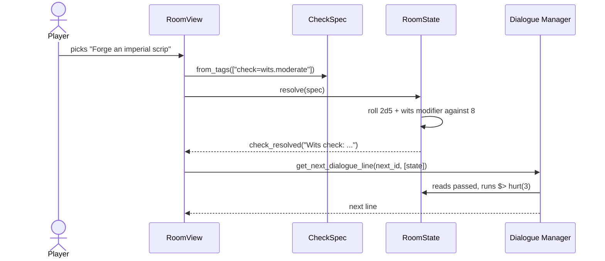
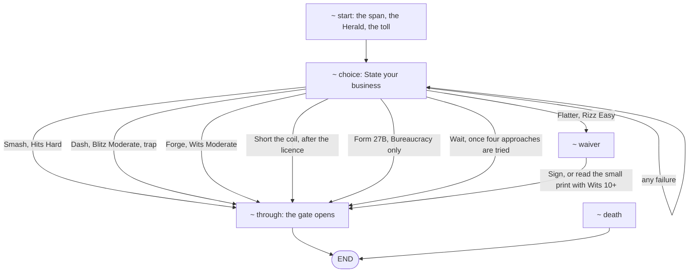
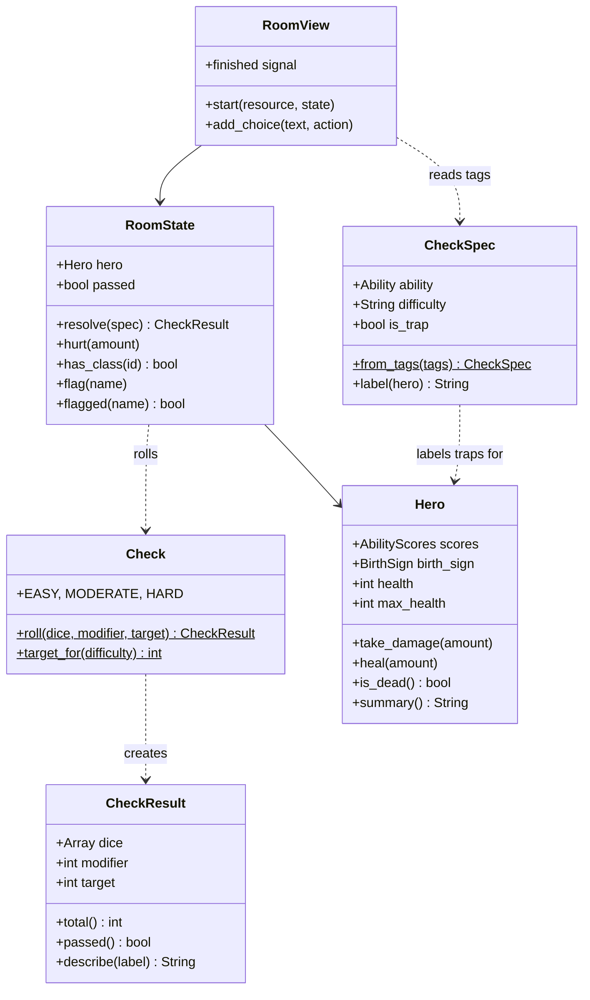

# Slice 3: Room Narrative

Part of the Five Room Dungeon Roguelite build plan. Version 1.0, October
2026.

This slice gives the hero somewhere to go. Pressing **Begin the delve**
now opens the first room, the Emperor's Tollgate: a passage of text, a
list of choices, and checks that roll 2d5 plus an ability modifier
against a target. Failures can hurt the hero, and a hero who reaches 0
health dies and can start again.

The room is written with the Dialogue Manager plugin. The Tollgate in
this guide is a first draft for you to rewrite in your own voice; its
tests check its mechanics, not its prose, so they keep passing as you
edit.

All the code in this document has been run against Godot 4.7.2,
gdUnit4 6.2.0 and Dialogue Manager 4.1.0: 73 tests pass, no script
raises a warning, and a scripted playthrough of the main scene reached
both the success and the death endings.

## Specification

### Goals

1. Dialogue Manager installed, with room files in `res://narrative/rooms`.
2. The check rule from the design overview: 2d5 plus a modifier, equal
   to or over Easy 6, Moderate 8 or Hard 10.
3. Checks attached to choices by tags, labelled with their ability and
   difficulty, and printed in the log when rolled.
4. Bureaucracy's boon working: +2 on checks against traps, and trap
   choices labelled for that hero.
5. A playable Tollgate room that uses all five abilities, the hero's
   species, class and sign, health loss and death.

### Out of scope

- Glitz tests (slice 4, alongside combat)
- Combat; the Tollgate's guardian is beaten by checks for now
- The dungeon map and more than one room (slice 5)
- Typing effects, portraits and sound
- The other room template premises, which are kept in the overview

### Decisions

| Area | Decision |
| --- | --- |
| Narrative plugin | Dialogue Manager 4.1.x |
| First room | The Emperor's Tollgate, drafted by Claude for you to edit |
| Check visibility | Ability and difficulty shown on each choice, such as "(Wits, Moderate)" |
| Traps | Hidden unless the hero's sign reveals them |
| Random stream | A sixth stream, `NARRATIVE`, added at the end |
| Presentation | A gamebook-style scrolling log, cleared for each new room |
| Roll display | Dice printed in the log, such as "Wits check: 3 + 4 + 1 = 8 against 8, success" |
| Death | Health 0 jumps to the room's `death` cue, then offers **Start again** |
| Glitz tests | Deferred to slice 4 |

The Law of Fives applies to what the player sees. The sixth random
stream is a behind-the-scenes detail, so it is sized by need rather than
forced into five.

### How a choice is resolved



The view rolls the check before asking Dialogue Manager for the branch
that follows, so the branch can read `passed` to choose between success
and failure.

### Why tags rather than mutations

A check could be written as a mutation inside the branch, such as
`$> check("wits", "moderate")`, and `RoomState` supports that for checks
that are not tied to a choice. For choices, a tag is better: the view
can read the tag before the choice is made, so the label "(Wits,
Moderate)" always matches the check that is rolled. Both come from one
line of the room file.

### The Tollgate's structure



Each approach can be tried once; a flag hides it afterwards. The waiting
option appears only once smashing, dashing, forging and flattering have
all been tried, so the room can always be finished.

### Architecture for this slice



`Check`, `CheckResult`, `CheckSpec` and `RoomState` are plain core
classes with no dependency on Dialogue Manager, so they are tested like
everything else. Only `RoomView` and the Tollgate test touch the plugin.

### New and changed files

```text
res://
├── addons/dialogue_manager/            (new plugin)
├── core/
│   ├── character/
│   │   ├── birth_sign.gd               (changed)
│   │   └── hero.gd                     (changed)
│   ├── dice/rng_streams.gd             (changed)
│   ├── narrative/
│   │   ├── check_spec.gd
│   │   └── room_state.gd
│   └── rules/
│       ├── check.gd
│       └── check_result.gd
├── data/signs/bureaucracy.tres         (changed)
├── docs/03-room-narrative.md
├── narrative/rooms/tollgate.dialogue
├── project.godot                       (changed)
├── tests/
│   ├── core/
│   │   ├── character/hero_test.gd      (changed)
│   │   ├── dice/rng_streams_test.gd    (changed)
│   │   ├── narrative/
│   │   │   ├── check_spec_test.gd
│   │   │   └── room_state_test.gd
│   │   └── rules/
│   │       ├── check_result_test.gd
│   │       └── check_test.gd
│   └── narrative/tollgate_test.gd
└── ui/
    ├── main/
    │   ├── main.gd                     (changed)
    │   └── main.tscn                   (changed)
    └── room/
        ├── room_view.gd
        └── room_view.tscn
```

### Definition of done

- [ ] Dialogue Manager is installed and enabled, with its **Dialogue**
      tab showing in the editor.
- [ ] The project opens with no errors or warnings.
- [ ] Pressing **Begin the delve** shows the Tollgate, with every
      choice that needs a check labelled with its ability and
      difficulty.
- [ ] The dash choice is labelled as a trap for a hero born under
      Bureaucracy.
- [ ] Each check's dice appear in the log, and the map panel's health
      falls when the hero is hurt.
- [ ] Getting through the gate, or dying, ends the room with **Start
      again**, which begins a new run.
- [ ] The Tollgate has been edited in your own voice.
- [ ] All tests pass in the editor and in GitHub Actions.
- [ ] The work is merged into `main` through a pull request and tagged
      `slice-03`.

## Walkthrough

### Step 1: Create the branch

```bash
git switch main
git pull
git switch -c 5rdr-0003
```

### Step 2: Install Dialogue Manager

1. Open the **AssetLib** tab and search for **Dialogue Manager** by
   Nathan Hoad. Install version **4.1.x**, selecting only the
   `addons/dialogue_manager` folder. If the listed version is older,
   download the v4.1.0 release from the plugin's GitHub releases page
   instead and copy its `addons/dialogue_manager` folder into your
   project.
2. In **Project → Project Settings → Plugins**, enable **Dialogue
   Manager**, and restart the editor when prompted.
3. Check that it worked. A **Dialogue** tab appears at the top of the
   editor next to 2D, 3D and Script, and **Project Settings → Globals →
   Autoload** lists `DialogueManager`.

Enabling the plugin adds that autoload to `project.godot`: a node that
exists for the whole game, which is how scripts reach the plugin as
`DialogueManager` from anywhere. The project's directory rules already
exclude `res://addons` from your strict warnings, so the plugin's own
code will not trip them.

Version 4 renamed several things from version 3, so ignore older
tutorials: "titles" are now **cues**, response conditions now end with
`/]`, and mutations start with `$>` rather than `do` or `set`.

Commit the addon and `project.godot`: `build: add Dialogue Manager`.

### Step 3: A sixth random stream

Room checks need their own stream, so changing how often rooms roll
cannot change anything else. Add `NARRATIVE` to the **end** of the enum
in `core/dice/rng_streams.gd`:

```gdscript
enum Stream { CHARACTERS, DUNGEON, ENCOUNTERS, COMBAT, LOOT, NARRATIVE }
```

The stream's doc comment already warns against inserting streams in the
middle. Now add a test that enforces it. Append this to
`tests/core/dice/rng_streams_test.gd`:

```gdscript
func test_existing_streams_keep_their_sequences() -> void:
	# Arrange
	# Recorded on main before the NARRATIVE stream was added. If this fails,
	# a stream was inserted or reordered, and every old seed has changed.
	var expected: Array[int] = [3688321001, 1710136774, 3747700061, 1600984951, 4202888916]
	var streams := RngStreams.new(SEED)

	# Act
	var actual: Array[int] = []
	for stream: int in range(expected.size()):
		actual.append(streams.get_stream(stream as RngStreams.Stream).randi())

	# Assert
	assert_array(actual).is_equal(expected)
```

The five numbers are each stream's first draw for seed 23, recorded on
`main` before this change. This is sometimes called a golden test: it
fails if anyone reorders the streams, which would silently change every
seed.

Commit: `feat(dice): add a narrative random stream`.

### Step 4: The check rule

Create `tests/core/rules/check_result_test.gd`:

```gdscript
extends GdUnitTestSuite
## Tests for CheckResult: totals, success at the target, and the roll text.


func test_total_adds_dice_and_modifier() -> void:
	# Arrange
	var result := CheckResult.new([3, 4], 1, 8)

	# Act
	var total := result.total()

	# Assert
	assert_int(total).is_equal(8)


func test_equalling_the_target_passes() -> void:
	# Arrange
	var result := CheckResult.new([3, 4], 1, 8)

	# Act
	var passed := result.passed()

	# Assert
	assert_bool(passed).is_true()


func test_margin_is_negative_on_a_failure() -> void:
	# Arrange
	var result := CheckResult.new([1, 2], 0, 8)

	# Act
	var margin := result.margin()

	# Assert
	assert_int(margin).is_equal(-5)


@warning_ignore("unused_parameter")
func test_describe(modifier: int, expected: String, test_parameters := [
		[1, "Wits check: 3 + 4 + 1 = 8 against 8, success"],
		[0, "Wits check: 3 + 4 = 7 against 8, failure"],
		[-2, "Wits check: 3 + 4 - 2 = 5 against 8, failure"]]) -> void:
	# Arrange
	var result := CheckResult.new([3, 4], modifier, 8)

	# Act
	var actual := result.describe("Wits check")

	# Assert
	assert_str(actual).is_equal(expected)
```

Then `core/rules/check_result.gd`:

```gdscript
class_name CheckResult
extends RefCounted
## The outcome of one check, with everything needed to show the roll.

var dice: Array[int] = []
var modifier: int = 0
var target: int = 0


func _init(rolled: Array[int], check_modifier: int, check_target: int) -> void:
	dice = rolled
	modifier = check_modifier
	target = check_target


## The dice plus the modifier.
func total() -> int:
	var sum := modifier
	for die: int in dice:
		sum += die
	return sum


## True if the total equals or beats the target.
func passed() -> bool:
	return total() >= target


## How far the total beat the target by; negative on a failure.
func margin() -> int:
	return total() - target


## The roll written out, such as "Wits check: 3 + 4 + 1 = 8 against 8, success".
func describe(label: String) -> String:
	var outcome := "success" if passed() else "failure"
	return "%s: %s = %d against %d, %s" % [label, _sum_text(), total(), target, outcome]


func _sum_text() -> String:
	var parts: Array[String] = []
	for die: int in dice:
		parts.append(str(die))
	var text := " + ".join(parts)
	if modifier > 0:
		text += " + %d" % modifier
	elif modifier < 0:
		text += " - %d" % -modifier
	return text
```

Create `tests/core/rules/check_test.gd`:

```gdscript
extends GdUnitTestSuite
## Tests for Check: the 2d5 roll and the named difficulties.

const SEED := 23


func test_roll_uses_two_dice() -> void:
	# Arrange
	var dice := Dice.new(RngStreams.new(SEED).get_stream(RngStreams.Stream.NARRATIVE))

	# Act
	var result := Check.roll(dice, 0, Check.MODERATE)

	# Assert
	assert_array(result.dice).has_size(2)


@warning_ignore("unused_parameter")
func test_target_for(difficulty: String, expected: int, test_parameters := [
		["easy", 6], ["moderate", 8], ["hard", 10]]) -> void:
	# Arrange
	# The difficulty and expected target come from test_parameters.

	# Act
	var actual := Check.target_for(difficulty)

	# Assert
	assert_int(actual).is_equal(expected)


func test_unknown_difficulty_is_rejected() -> void:
	# Arrange
	var difficulty := "impossible"

	# Act
	var known := Check.is_difficulty(difficulty)

	# Assert
	assert_bool(known).is_false()
```

Then `core/rules/check.gd`:

```gdscript
class_name Check
extends RefCounted
## The core check rule: 2d5 plus a modifier, equal to or over the target wins.

const DICE := 2
const EASY := 6
const MODERATE := 8
const HARD := 10
const DIFFICULTIES: Dictionary[String, int] = {
	"easy": EASY,
	"moderate": MODERATE,
	"hard": HARD,
}


## Rolls a check and returns the full result.
static func roll(dice: Dice, modifier: int, target: int) -> CheckResult:
	return CheckResult.new(dice.roll_each(DICE), modifier, target)


## True for "easy", "moderate" or "hard".
static func is_difficulty(difficulty: String) -> bool:
	return DIFFICULTIES.has(difficulty)


## The target number for a named difficulty.
static func target_for(difficulty: String) -> int:
	return DIFFICULTIES[difficulty]
```

`CheckResult` keeps the individual dice rather than only the total, so
the log can show the roll and a future slice can animate the dice.

`DIFFICULTIES` is a typed dictionary, `Dictionary[String, int]`, which
GDScript has supported since 4.4. Because the editor knows its values
are `int`, `target_for` can return `DIFFICULTIES[difficulty]` without a
cast.

`margin()` is not used yet; combat's margin-of-success damage in slice
4 is its first customer.

Run the tests. Commit: `feat(rules): add the check rule`.

### Step 5: Hero health

Rooms need to hurt the hero. Add these tests to the end of
`tests/core/character/hero_test.gd`:

```gdscript
func test_take_damage_stops_at_zero() -> void:
	# Arrange
	var hero := _make_hero(AbilityScores.new())

	# Act
	hero.take_damage(100)

	# Assert
	assert_int(hero.health).is_equal(0)
	assert_bool(hero.is_dead()).is_true()


func test_heal_stops_at_maximum() -> void:
	# Arrange
	var hero := _make_hero(AbilityScores.new())
	hero.take_damage(5)

	# Act
	hero.heal(100)

	# Assert
	assert_int(hero.health).is_equal(hero.max_health)
```

Then add these functions to `core/character/hero.gd`, above `defence()`:

```gdscript
## Loses health, never going below zero.
func take_damage(amount: int) -> void:
	health = maxi(health - amount, 0)


## Regains health, never going above the maximum.
func heal(amount: int) -> void:
	health = mini(health + amount, max_health)


func is_dead() -> bool:
	return health <= 0
```

And change `summary()` so it shows current health against the maximum:

```gdscript
## A one-line description and the key numbers, for display.
func summary() -> String:
	return "%s %s, born under %s\nHealth %d/%d   Defence %d   Glitz %d" % [
		species.display_name, character_class.display_name,
		birth_sign.display_name, health, max_health, defence(), glitz]
```

`maxi` and `mini` are the integer versions of `max` and `min`. The
plain versions return a `Variant`, which strict typing would flag.

Run the tests. Commit: `feat(character): add damage and healing`.

### Step 6: The trap boon in data

Add two fields to the end of `core/character/birth_sign.gd`:

```gdscript
## Added to this character's checks against traps.
@export var trap_check_bonus: int = 0
## Whether this character sees which choices lead into traps.
@export var labels_traps: bool = false
```

Open `data/signs/bureaucracy.tres` in the Inspector and set **Trap
Check Bonus** to 2 and tick **Labels Traps**. Save it.

The boon could have been written as `if sign is Bureaucracy` in code,
but data fields keep the rule with the sign it belongs to, and any
future sign or item can reuse them.

Commit: `feat(character): give Bureaucracy its trap boon`.

### Step 7: Check specs

A check spec is a check waiting to happen: an ability, a difficulty and
whether it is a trap, read from a choice's tags. Create
`tests/core/narrative/check_spec_test.gd`:

```gdscript
extends GdUnitTestSuite
## Tests for CheckSpec: reading check tags and labelling choices.


func test_from_tags_reads_ability_and_difficulty() -> void:
	# Arrange
	var tags := PackedStringArray(["check=wits.moderate"])

	# Act
	var spec := CheckSpec.from_tags(tags)

	# Assert
	assert_int(spec.ability).is_equal(AbilityScores.Ability.WITS)
	assert_int(spec.target()).is_equal(Check.MODERATE)
	assert_bool(spec.is_trap).is_false()


func test_from_tags_reads_the_trap_tag() -> void:
	# Arrange
	var tags := PackedStringArray(["check=blitz.hard", "trap"])

	# Act
	var spec := CheckSpec.from_tags(tags)

	# Assert
	assert_bool(spec.is_trap).is_true()


func test_from_tags_without_a_check_gives_null() -> void:
	# Arrange
	var tags := PackedStringArray(["mood=grumpy"])

	# Act
	var spec := CheckSpec.from_tags(tags)

	# Assert
	assert_object(spec).is_null()


func test_label_hides_traps_from_most_signs() -> void:
	# Arrange
	var spec := CheckSpec.create("blitz", "moderate", true)
	var hero := _make_hero(false)

	# Act
	var label := spec.label(hero)

	# Assert
	assert_str(label).is_equal("Blitz, Moderate")


func test_label_shows_traps_to_signs_that_reveal_them() -> void:
	# Arrange
	var spec := CheckSpec.create("blitz", "moderate", true)
	var hero := _make_hero(true)

	# Act
	var label := spec.label(hero)

	# Assert
	assert_str(label).is_equal("Blitz, Moderate, trap")


func _make_hero(labels_traps: bool) -> Hero:
	var birth_sign := BirthSign.new()
	birth_sign.labels_traps = labels_traps
	return Hero.create(Species.new(), CharacterClass.new(), birth_sign, AbilityScores.new(), 8)
```

Then `core/narrative/check_spec.gd`:

```gdscript
class_name CheckSpec
extends RefCounted
## A check described in dialogue, such as a response tagged
## [#check=wits.moderate] or [#check=blitz.hard, #trap].

const CHECK_TAG := "check"
const TRAP_TAG := "trap"

var ability := AbilityScores.Ability.HITS
var difficulty := "moderate"
var is_trap := false


## Builds a spec from an ability and difficulty name, or returns null if
## either is not recognised.
static func create(ability_name: String, difficulty_name: String, trap := false) -> CheckSpec:
	var index := AbilityScores.Ability.keys().find(ability_name.to_upper())
	if index == -1 or not Check.is_difficulty(difficulty_name):
		push_error("Unknown check: %s.%s" % [ability_name, difficulty_name])
		return null
	var spec := CheckSpec.new()
	spec.ability = index as AbilityScores.Ability
	spec.difficulty = difficulty_name
	spec.is_trap = trap
	return spec


## Reads a spec from a response's tags, or returns null if it has none.
static func from_tags(tags: PackedStringArray) -> CheckSpec:
	var prefix := CHECK_TAG + "="
	for tag: String in tags:
		if tag.begins_with(prefix):
			var parts := tag.trim_prefix(prefix).split(".")
			var difficulty_name := parts[1] if parts.size() > 1 else ""
			return create(parts[0], difficulty_name, tags.has(TRAP_TAG))
	return null


## The target number for this check's difficulty.
func target() -> int:
	return Check.target_for(difficulty)


## The label shown after a choice, such as "Blitz, Moderate". Traps are
## only labelled for heroes whose sign reveals them.
func label(hero: Hero) -> String:
	var text := "%s, %s" % [AbilityScores.display_name(ability), difficulty.capitalize()]
	if is_trap and hero.birth_sign.labels_traps:
		text += ", trap"
	return text
```

Dialogue Manager turns `[#check=wits.moderate, #trap]` into the tags
`"check=wits.moderate"` and `"trap"`, which is what `from_tags` reads.

`create` finds the ability by looking its name up in
`AbilityScores.Ability.keys()`. The position it is found at is the
enum's value, and `index as AbilityScores.Ability` converts it without
a warning. An unknown ability or difficulty logs an error and returns
`null`, so a typo in a room file shows up in the Output panel rather
than as a silent wrong check; the Tollgate test in step 10 also checks
every tag.

Run the tests. Commit: `feat(narrative): read checks from tags`.

### Step 8: Room state

`RoomState` is everything a room's dialogue can see and change. Create
`tests/core/narrative/room_state_test.gd`:

```gdscript
extends GdUnitTestSuite
## Tests for RoomState: checks, the trap bonus, damage and flags.

const SEED := 23


func test_resolve_records_whether_the_check_passed() -> void:
	# Arrange
	var state := _make_state(0)
	var spec := CheckSpec.create("wits", "moderate")

	# Act
	var result := state.resolve(spec)

	# Assert
	assert_bool(state.passed).is_equal(result.passed())


func test_resolve_adds_the_trap_bonus_to_traps() -> void:
	# Arrange
	var state := _make_state(2)
	state.hero.scores.blitz = 13
	var spec := CheckSpec.create("blitz", "moderate", true)

	# Act
	var result := state.resolve(spec)

	# Assert
	assert_int(result.modifier).is_equal(4)


func test_resolve_ignores_the_trap_bonus_elsewhere() -> void:
	# Arrange
	var state := _make_state(2)
	state.hero.scores.blitz = 13
	var spec := CheckSpec.create("blitz", "moderate")

	# Act
	var result := state.resolve(spec)

	# Assert
	assert_int(result.modifier).is_equal(2)


func test_resolve_emits_the_roll_text() -> void:
	# Arrange
	var state := _make_state(0)
	var spec := CheckSpec.create("rizz", "easy")
	var texts: Array[String] = []
	state.check_resolved.connect(func(text: String) -> void: texts.append(text))

	# Act
	state.resolve(spec)

	# Assert
	assert_str(texts[0]).starts_with("Rizz check: ")


func test_hurt_reduces_health() -> void:
	# Arrange
	var state := _make_state(0)
	var start := state.hero.health

	# Act
	state.hurt(3)

	# Assert
	assert_int(state.hero.health).is_equal(start - 3)


func test_flags_start_unset() -> void:
	# Arrange
	var state := _make_state(0)

	# Act
	state.flag("smash")

	# Assert
	assert_bool(state.flagged("smash")).is_true()
	assert_bool(state.flagged("dash")).is_false()


func test_has_class_matches_the_id() -> void:
	# Arrange
	var state := _make_state(0)
	state.hero.character_class.id = &"fighter"

	# Act
	var matches := state.has_class("fighter")

	# Assert
	assert_bool(matches).is_true()


func _make_state(trap_bonus: int) -> RoomState:
	var birth_sign := BirthSign.new()
	birth_sign.trap_check_bonus = trap_bonus
	var hero := Hero.create(Species.new(), CharacterClass.new(), birth_sign, AbilityScores.new(), 8)
	var dice := Dice.new(RngStreams.new(SEED).get_stream(RngStreams.Stream.NARRATIVE))
	return RoomState.new(hero, dice)
```

Then `core/narrative/room_state.gd`:

```gdscript
class_name RoomState
extends RefCounted
## What a room's dialogue can see and change: the hero, checks and flags.
##
## The room passes this to Dialogue Manager as an extra game state, so
## its properties and methods can be used in dialogue by name, such as
## `passed`, `hurt(3)` or `has_class("fighter")`.

signal check_resolved(text: String)
signal hero_changed

var hero: Hero
## Whether the most recent check succeeded.
var passed := false

var _dice: Dice
var _flags: Dictionary[String, bool] = {}


func _init(room_hero: Hero, dice: Dice) -> void:
	hero = room_hero
	_dice = dice


## Rolls a check, adding the hero's sign bonus if it is a trap.
func resolve(spec: CheckSpec) -> CheckResult:
	var modifier := hero.scores.modifier(spec.ability)
	if spec.is_trap:
		modifier += hero.birth_sign.trap_check_bonus
	var result := Check.roll(_dice, modifier, spec.target())
	passed = result.passed()
	check_resolved.emit(result.describe(AbilityScores.display_name(spec.ability) + " check"))
	return result


## A check called from dialogue, such as `$> check("wits", "easy")`.
func check(ability_name: String, difficulty_name: String) -> void:
	var spec := CheckSpec.create(ability_name, difficulty_name)
	if spec != null:
		resolve(spec)


func hurt(amount: int) -> void:
	hero.take_damage(amount)
	hero_changed.emit()


func heal(amount: int) -> void:
	hero.heal(amount)
	hero_changed.emit()


func has_class(id: String) -> bool:
	return hero.character_class.id == StringName(id)


func has_species(id: String) -> bool:
	return hero.species.id == StringName(id)


func has_sign(id: String) -> bool:
	return hero.birth_sign.id == StringName(id)


## Marks something as having happened in this room.
func flag(flag_name: String) -> void:
	_flags[flag_name] = true


func flagged(flag_name: String) -> bool:
	return _flags.has(flag_name)
```

Dialogue Manager calls this an extra game state. When the view asks for
a line, it passes `[state]`, and the plugin looks up names used in the
room file on that object: `passed`, `hero.health`, `hurt(4)`,
`has_class("fighter")`.

The helpers are called `has_class`, `has_species` and `has_sign`
because every Godot object already has an `is_class()` method, and
GDScript refuses to let a script replace it.

Run the tests. Commit: `feat(narrative): add room state`.

### Step 9: The Tollgate room

Create the folder `narrative/rooms`. Then either open the **Dialogue**
tab, click **New dialogue file** and save it as
`res://narrative/rooms/tollgate.dialogue`, or create the file in VS
Code. Paste in the draft:

```text
~ start

The viaduct narrows to a single span of riveted iron, humming with the lightning rail beneath it. Across the span stands a gate of brass bars, each one stamped with the imperial seal\: a crown balanced, improbably, on an apple.
Before the gate waits the Herald, a clockwork functionary twice your height. Its chest is a ledger and its face is a speaking-trumpet.
Herald: HALT. By decree of His Imperial Majesty, all persons crossing the Fifth Span must pay the toll.
Herald: The toll is one imperial scrip. Imperial scrip is issued by His Majesty on the occasion of his birthday, which is never.
if has_species("human")
	Herald: Species: human. Category: tolerated. Proceed to the paying of the toll.
% A spark crawls along the gate bars and fizzles out with an apologetic pop.
% Somewhere below, a rail carriage screams past, and the whole span shivers.
% A pigeon lands on the gate. The Herald fines it for loitering.
=> choice

~ choice

Herald: State your business, {{hero.character_class.display_name}}. You have {{hero.health}} units of health remaining, for the purposes of the form.
- Smash the Herald's speaking-trumpet [#check=hits.hard] [if not flagged("smash") /]
	$> flag("smash")
	if passed
		You drive your fist into the trumpet. It folds like a cheap hat, and the Herald's voice becomes a mournful kazoo.
		Herald: Hnnnrrk. Gate. Open.
		=> through
	else
		The trumpet is sturdier than it looks. The Herald's reply, at very close range, is a blast of sound that lifts you off your feet.
		$> hurt(4)
		=> choice
- Dash between the Herald's legs [#check=blitz.moderate, #trap] [if not flagged("dash") /]
	$> flag("dash")
	if passed
		Halfway through, you notice the pressure plate, and you leap it like a hurdle. You land on the far side of the gate before the Herald has finished turning its head.
		=> through
	else
		Halfway through, your boot finds a pressure plate. The gate bars discharge into you with a noise like a sneeze.
		$> hurt(5)
		=> choice
- Forge an imperial scrip [#check=wits.moderate] [if not flagged("forge") /]
	$> flag("forge")
	if passed
		You produce a scrip from an old rail ticket and some confident handwriting. The Herald studies it, stamps it twice and files it in its chest.
		Herald: Payment accepted. Happy birthday, Majesty.
		=> through
	else
		The Herald holds your forgery up to the light.
		Herald: The Emperor's name does not have three Z's. Your attempt has been filed under "Treason, Minor".
		=> choice
- Show your guild licence (Fighter) [if has_class("fighter") and not flagged("licence") /]
	$> flag("licence")
	Herald: A guild licence is not legal tender. However, I am obliged to inform licensed persons that this gate is maintained from a spark coil in my left knee.
	Herald: That information was obligatory. I regret it.
	=> choice
- Short the spark coil in the Herald's knee [#check=whizz.moderate] [if flagged("licence") and not flagged("coil") /]
	$> flag("coil")
	if passed
		You find the coil exactly where the Herald said. A flick of power, a smell of hot brass, and the Herald sits down very suddenly.
		=> through
	else
		The coil bites back. Your arm is numb to the shoulder.
		$> hurt(3)
		=> choice
- Request form 27B, Toll Exemption (Bureaucracy) [#check=wits.easy] [if has_sign("bureaucracy") and not flagged("form") /]
	$> flag("form")
	if passed
		Herald: Form 27B. Correctly completed. In triplicate.
		Herald: I have waited so long for someone to ask.
		=> through
	else
		You fill in the form in the wrong colour of ink. The Herald shreds it with visible grief.
		=> choice
- Flatter the Herald [#check=rizz.easy] [if not flagged("flatter") /]
	$> flag("flatter")
	if passed
		Herald: Nobody has ever complimented my ledger before. I can waive the toll if you sign the waiver.
		=> waiver
	else
		Herald: Flattery of an imperial officer is an offence. I am, however, flattered. I will let it go.
		=> choice
- Wait for the Herald's spring to run down [if flagged("smash") and flagged("dash") and flagged("forge") and flagged("flatter") /]
	You sit on the parapet and wait. Hours pass. At sundown the Herald winds down mid-sentence, and the gate swings open in the evening breeze.
	A passing rail carriage clips you on your way through.
	$> hurt(2)
	=> through

~ waiver

The Herald extends a form, a quill and an expectant silence.
- Sign the waiver
	Herald: Signed and sealed. Your soul is now the property of the Imperial Treasury, which will not be collecting it this year.
	=> through
- Read the small print first [if hero.scores.wits >= 10 /]
	The small print, in a hand the size of a flea, transfers your soul to the Imperial Treasury. You strike out the clause and initial it.
	Herald: Amended and accepted. You are the first person to read that in eleven years.
	=> through

~ through

The gate grinds open. Beyond it, the Fifth Span carries on into the Emperor's district\: towers of bunting, lightning-lamps and a great many more forms.
Scratched into the inside of the gate, at knee height, is a crude drawing of an apple with five bites taken out of it.
=> END

~ death

You fall on the riveted iron of the Fifth Span. The Herald consults its ledger, finds no column for this, and files you under "Miscellaneous".
=> END
```

Dialogue Manager reads indentation as structure, like Python, and it
must be **tabs**. If you edit in VS Code, check the indentation shown in
the status bar; a file indented with spaces will not parse. The
Dialogue tab shows errors as you type, which makes it the safest place
to edit.

#### The syntax used here

| Syntax | Meaning |
| --- | --- |
| `~ choice` | A cue: a named point to start from or jump to |
| `=> choice` | Jump to a cue; `=> END` ends the room |
| `Herald: text` | A line spoken by a character; lines without a name are narration |
| `- text` | A choice; the indented lines below it are its branch |
| `[if condition /]` | Shows a choice only when the condition is true |
| `[#check=wits.moderate]` | A tag; this game reads it as a check |
| `$> hurt(4)` | A mutation: calls a `RoomState` method |
| `if passed` / `else` | Branches on the result of the last check |
| `% text` | One of these lines is picked at random |
| `{{hero.health}}` | Inserts a value into the text |

Every non-trivial feature of slices 2 and 3 appears somewhere: each
ability has a check; the human gets a line of their own; the fighter
and the Bureaucrat each get an option no one else would; the waiver's
small print needs Wits 10; and four branches can hurt.

When Godot imports the file it creates `tollgate.dialogue.import`
beside it, and Dialogue Manager registers the file for translation in
`project.godot`. Commit all of them: `feat(narrative): draft the
Tollgate room`.

### Step 10: Test the room

These tests play the real file through Dialogue Manager. Create
`tests/narrative/tollgate_test.gd`:

```gdscript
extends GdUnitTestSuite
## Plays the real Tollgate room through Dialogue Manager.

const TOLLGATE := "res://narrative/rooms/tollgate.dialogue"
const SEED := 23


func test_first_choice_has_a_check_for_every_ability() -> void:
	# Arrange
	var state := _make_state()

	# Act
	var line := await _first_choice(state)

	# Assert
	var abilities: Array[AbilityScores.Ability] = []
	for response: DialogueResponse in line.responses:
		var spec := CheckSpec.from_tags(response.tags)
		if spec != null and not abilities.has(spec.ability):
			abilities.append(spec.ability)
	assert_int(abilities.size()).is_equal(5)


func test_licence_option_is_only_for_fighters() -> void:
	# Arrange
	var state := _make_state()
	state.hero.character_class = CharacterClass.new()

	# Act
	var line := await _first_choice(state)

	# Assert
	assert_array(_texts(line)).not_contains(["Show your guild licence (Fighter)"])


func test_every_check_tag_is_valid() -> void:
	# Arrange
	var state := _make_state()

	# Act
	var line := await _first_choice(state)

	# Assert
	for response: DialogueResponse in line.responses:
		var has_tag := Array(response.tags).any(
				func(tag: String) -> bool: return tag.begins_with("check="))
		if has_tag:
			assert_object(CheckSpec.from_tags(response.tags)).is_not_null()


func test_a_failed_trap_hurts_the_hero() -> void:
	# Arrange
	var state := _make_state()
	var line := await _first_choice(state)
	var dash := _response(line, "Dash between the Herald's legs")
	state.passed = false
	var start_health := state.hero.health

	# Act
	var resource: DialogueResource = load(TOLLGATE)
	var next := await resource.get_next_dialogue_line(dash.next_id, [state])
	await resource.get_next_dialogue_line(next.next_id, [state])

	# Assert
	assert_int(state.hero.health).is_equal(start_health - 5)


func _first_choice(state: RoomState) -> DialogueLine:
	var resource: DialogueResource = load(TOLLGATE)
	var line := await resource.get_next_dialogue_line("start", [state])
	while line != null and line.responses.is_empty():
		line = await resource.get_next_dialogue_line(line.next_id, [state])
	return line


func _response(line: DialogueLine, text: String) -> DialogueResponse:
	for response: DialogueResponse in line.responses:
		if response.text == text:
			return response
	return null


func _texts(line: DialogueLine) -> Array[String]:
	var texts: Array[String] = []
	for response: DialogueResponse in line.responses:
		if response.is_allowed:
			texts.append(response.text)
	return texts


func _make_state() -> RoomState:
	var hero := Hero.create(
			load("res://data/species/human.tres") as Species,
			load("res://data/classes/fighter.tres") as CharacterClass,
			load("res://data/signs/bureaucracy.tres") as BirthSign,
			AbilityScores.new(), 8)
	var dice := Dice.new(RngStreams.new(SEED).get_stream(RngStreams.Stream.NARRATIVE))
	return RoomState.new(hero, dice)
```

Two Dialogue Manager behaviours show up here. First,
`get_next_dialogue_line` is a coroutine, so every call needs `await`,
and so does every helper that calls it. Second, it returns all of a
line's responses, with `is_allowed` set to `false` on those whose
condition failed; it is up to the game to hide them.

The tests check mechanics, not wording: that a check exists for each
ability, that every check tag is valid, that the licence is fighters
only, and that a failed dash costs 5 health. Keep the choice texts
"Dash between the Herald's legs" and "Show your guild licence
(Fighter)" when you edit, or update the tests to match.

Run the tests. Commit: `test(narrative): play the Tollgate room`.

### Step 11: The room view

#### Build the scene

1. **Scene → New Scene**, choose **Other Node**, and pick
   `VBoxContainer`. Rename it `RoomView`.
2. Add two children:

```text
RoomView (VBoxContainer)
├── LogLabel (RichTextLabel)     unique name
└── ChoiceList (VBoxContainer)   unique name
```

3. Set these properties on `LogLabel`:

| Property | Value |
| --- | --- |
| BBCode Enabled | On |
| Scroll Following | On |
| Layout → Custom Minimum Size → x | 240 |
| Layout → Container Sizing → Vertical | Fill, with **Expand** ticked |

4. Mark both children **Access as Unique Name**.
5. Save the scene as `ui/room/room_view.tscn`, attach a script to
   `RoomView` at `res://ui/room/room_view.gd`, replace its contents with
   the code below, and **save the scene again**.

```gdscript
class_name RoomView
extends VBoxContainer
## Plays a room's dialogue as a scrolling log with a list of choices.
##
## Lines without choices are shown straight away, so a whole passage
## appears at once, like a page of a gamebook.

signal finished

const START_CUE := "start"
const DEATH_CUE := "death"

var _resource: DialogueResource
var _state: RoomState
var _death_shown := false

@onready var _log_label: RichTextLabel = %LogLabel
@onready var _choice_list: VBoxContainer = %ChoiceList


## Clears the log and plays a room from its start cue.
func start(resource: DialogueResource, state: RoomState) -> void:
	_resource = resource
	_state = state
	_death_shown = false
	_log_label.clear()
	_state.check_resolved.connect(_on_check_resolved)
	_go_to(START_CUE)


## Adds a button to the list of choices.
func add_choice(text: String, action: Callable) -> void:
	var button := Button.new()
	button.text = text
	button.alignment = HORIZONTAL_ALIGNMENT_LEFT
	button.pressed.connect(action)
	_choice_list.add_child(button)


func _go_to(cue: String) -> void:
	_clear_choices()
	var line := await _resource.get_next_dialogue_line(cue, [_state])
	if _state.hero.is_dead() and not _death_shown:
		_death_shown = true
		_go_to(DEATH_CUE)
	elif line == null:
		finished.emit()
	else:
		_show(line)


func _show(line: DialogueLine) -> void:
	_append(_format(line))
	if line.responses.is_empty():
		_go_to(line.next_id)
		return
	for response: DialogueResponse in line.responses:
		if response.is_allowed:
			add_choice(_choice_text(response), _choose.bind(response))


func _choose(response: DialogueResponse) -> void:
	_append("[i]> %s[/i]" % response.text)
	var spec := CheckSpec.from_tags(response.tags)
	if spec != null:
		_state.resolve(spec)
	_go_to(response.next_id)


func _choice_text(response: DialogueResponse) -> String:
	var spec := CheckSpec.from_tags(response.tags)
	if spec == null:
		return response.text
	return "%s (%s)" % [response.text, spec.label(_state.hero)]


func _format(line: DialogueLine) -> String:
	if line.character.is_empty():
		return line.text
	return "[b]%s:[/b] %s" % [line.character, line.text]


func _append(text: String) -> void:
	_log_label.append_text(text + "\n\n")


func _clear_choices() -> void:
	for child: Node in _choice_list.get_children():
		child.queue_free()


func _on_check_resolved(text: String) -> void:
	_append("[color=gray][i]%s[/i][/color]" % text)
```

`_go_to` uses `await`, so it pauses until Dialogue Manager has the next
line. Anything that calls it without `await`, such as a button's
`pressed` signal, simply carries on; the view updates when the line
arrives.

`[i]`, `[b]` and `[color]` are BBCode, which `RichTextLabel` renders as
formatting. Choices are echoed into the log in italics so the log reads
as a record of what happened.

Commit: `feat(ui): add the room view`.

### Step 12: Start the room from the main scene

1. Open `ui/main/main.tscn`.
2. Right-click `ContentPanel`, choose **Instantiate Child Scene**, pick
   `ui/room/room_view.tscn`, and mark the new `RoomView` as a unique
   name. `ContentPanel` now holds both the creation screen and the room
   view; only one is visible at a time.
3. Replace the contents of `ui/main/main.gd` with:

```gdscript
extends Control
## Starts a new run: character creation, then the first room.

const FIRST_ROOM: DialogueResource = preload("res://narrative/rooms/tollgate.dialogue")

var _streams: RngStreams

@onready var _map_label: Label = %MapLabel
@onready var _creation_screen: CreationScreen = %CreationScreen
@onready var _room_view: RoomView = %RoomView


func _ready() -> void:
	_streams = RngStreams.new(RngStreams.random_seed())
	_creation_screen.setup(_dice(RngStreams.Stream.CHARACTERS))
	_creation_screen.hero_created.connect(_on_hero_created)
	_room_view.finished.connect(_on_room_finished)
	_room_view.hide()
	_map_label.text = "Seed %d" % _streams.run_seed


func _on_hero_created(hero: Hero) -> void:
	var state := RoomState.new(hero, _dice(RngStreams.Stream.NARRATIVE))
	state.hero_changed.connect(_show_hero.bind(hero))
	_show_hero(hero)
	_creation_screen.hide()
	_room_view.show()
	_room_view.start(FIRST_ROOM, state)


func _on_room_finished() -> void:
	_room_view.add_choice("Start again", _restart)


func _show_hero(hero: Hero) -> void:
	_map_label.text = "%s\n\nSeed %d" % [hero.summary(), _streams.run_seed]


func _restart() -> void:
	get_tree().reload_current_scene()


func _dice(stream: RngStreams.Stream) -> Dice:
	return Dice.new(_streams.get_stream(stream))
```

`preload` loads the room when the script loads, rather than when the
line runs, so a missing or misspelt path is an error as soon as the
project starts.

`reload_current_scene` throws away the whole main scene and builds it
again, which is the simplest way to start a new run with a fresh seed.
Slice 6 replaces this with a proper run loop.

Press **F5**, create a hero and play the room. Try a few runs: the
random line at the start changes, and the checks can go either way.

Commit: `feat(ui): play the first room after creation`.

### Step 13: Make the room yours

Rewrite the Tollgate in your own voice. Change any prose, add lines,
rename the Herald, add choices. Run the tests and play it as you go.

Keep these working, or update the tests and code that rely on them:

- The `start` and `death` cues, which `RoomView` uses
- A check tag for each of the five abilities
- The two choice texts the tests look up
- A way through when every approach has been tried, so the room cannot
  trap the player

Commit: `docs(narrative): rewrite the Tollgate`.

### Step 14: Finish the slice

1. Run all tests in the editor; there should be 73.
2. Copy this document to `docs/03-room-narrative.md` and tick the
   [definition of done](#definition-of-done). Commit:
   `docs: add slice 3 guide`.
3. Push the branch, open a pull request into `main`, check that CI
   passes, and merge.
4. Tag the merge commit:

```bash
git switch main
git pull
git tag slice-03
git push --tags
```

## Troubleshooting

| Symptom | Likely cause |
| --- | --- |
| `Identifier "DialogueResource" not declared` | The plugin is not enabled, or the editor was not restarted after enabling it |
| The room file shows errors in the Dialogue tab | Indentation uses spaces instead of tabs, or a response condition is missing its closing `/]` |
| A choice has no label | Its tag is misspelt; check the Output panel for "Unknown check" |
| Every choice appears, including ones that should be hidden | The view is not checking `response.is_allowed` |
| Health falls but the map panel does not change | `hero_changed` is not connected in `main.gd` |
| The room never ends after death | The room file has no `~ death` cue |
| CI cannot load the `.dialogue` file | `project.godot` or the plugin folder was not committed, so CI cannot import dialogue files |
| `The method "is_class()" overrides a method from native class "Object"` | A `RoomState` helper was named `is_class`; use `has_class` |

To run the tests from a terminal:

```bash
export GODOT_BIN=/path/to/godot
./addons/gdUnit4/runtest.sh --headless --ignoreHeadlessMode -a res://tests
```

## Next slice

Slice 4, combat, brings in initiative, margin-of-success attacks and
glitz tests, for a party of one against one or more enemies. Before it
starts, open questions 1 to 4 in the overview need answers: the exact
glitz test roll, how resistances work, weapon and armour values, and the
fighter's five actions. The Tollgate's Smash option can then become a
real fight.